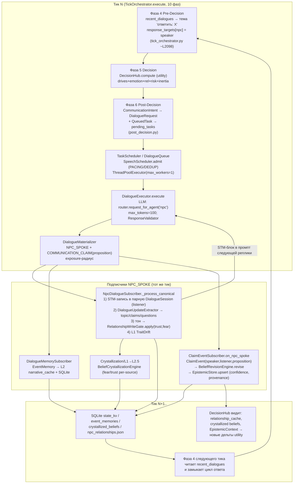
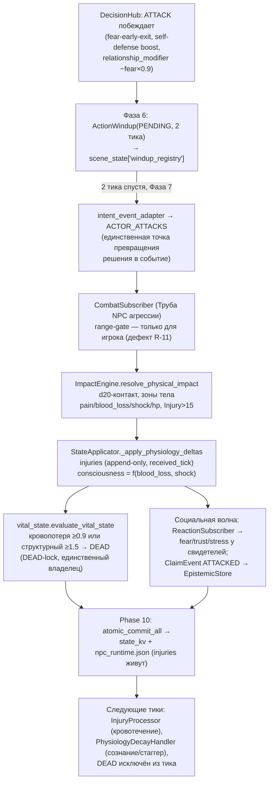

# Эксперимент длительной автономной коммуникации NPC в ENIGMA

**Документ:** `docs/experiments/NPC_AUTONOMOUS_LONGFORM_INTERACTION_EXPERIMENT.md`
**База исследования:** `Enigma-V.0.5.4.5.6-3` (полная выгрузка репозитория, backend ≈ 580 py-файлов, ~125 тыс. строк)
**Участники эксперимента:** `maid_lusya` (Люся), `tavern_keeper_tornin` (Торнин), `blacksmith_orm` (гном-кузнец Орм)
**Статус:** техническая инструкция. Реализация по этому документу ещё не начата; здесь зафиксированы результаты архитектурной археологии и пошаговый план.
**Правило документа:** каждое техническое утверждение снабжено ссылкой на файл/класс/метод. Утверждения, которые не удалось подтвердить кодом, явно помечены `НЕ ПРОВЕРЕНО` и вынесены в список проверок. Предположения не выдаются за реализованные возможности.

---

## Содержание

1. [Замысел и игровые принципы](#1-замысел-и-игровые-принципы)
2. [Три персонажа и фиксируемое начальное состояние](#2-три-персонажа-и-фиксируемое-начальное-состояние)
3. [Фактическая карта существующей архитектуры](#3-фактическая-карта-существующей-архитектуры)
4. [Сводная таблица «УЖЕ СУЩЕСТВУЕТ / ЧАСТИЧНО / ОТСУТСТВУЕТ / НЕ ПРОВЕРЕНО»](#4-сводная-таблица)
5. [Диаграмма потока данных: от реплики до последствий](#5-диаграмма-потока-данных)
6. [Реестр разрывов](#6-реестр-разрывов)
7. [План реализации: изолированные этапы](#7-план-реализации)
8. [Протокол эксперимента](#8-протокол-эксперимента)
9. [Регистрируемые диагностические артефакты](#9-регистрируемые-артефакты)
10. [Критерии успешности](#10-критерии-успешности)
11. [Требования к сохранению и восстановлению состояния](#11-сохранение-и-восстановление)
12. [Точки разрыва и способы диагностики](#12-точки-разрыва-и-диагностика)
13. [Критерии готовности эксперимента](#13-критерии-готовности)
14. [План перехода от эксперимента к игровой функции](#14-переход-к-игровой-функции)

---

## 1. Замысел и игровые принципы

### 1.1. Что мы проверяем

Главный вопрос эксперимента: **способна ли ENIGMA самостоятельно породить историю, которую никто заранее не написал.**

Три NPC — Люся, Торнин и кузнец Орм — оказываются в одной социальной ситуации и взаимодействуют друг с другом без игрока. Мы не задаём тему, не программируем примирение, дружбу, конфликт, романтику или насилие. Мы наблюдаем, куда самостоятельно сдвинется мир, если предоставить NPC возможность длительного взаимодействия. Каждый исход, который логично вырастает из биографий, убеждений, незнания, потребностей и обстоятельств персонажей, — допустим.

### 1.2. Принцип невмешательства

Игрок в эксперименте **не участвует**: не инициирует разговор, не задаёт тему, не корректирует реплики, не направляет отношения. Архитектурно это соответствует уже существующему и явно спроектированному свойству ядра: `TickOrchestrator.execute()` — «Ядро не знает 'player'. Если interventions пуст — idle tick» (`backend/app/services/tick_orchestrator.py`, docstring метода `execute`, ~L515), а фаза решений фильтрует аватар: «INV-PLAYER-AUTHORSHIP… автономная decision population = только NPC_DECISION-акторы» (`services/tick_orchestrator.py` ~L2230–2239). То есть playerless-режим — не хак, а штатное свойство конвейера.

### 1.3. Допустимые исходы

Следующие направления развития считаются допустимыми и равноправными (перечень — не цели):

взаимное уважение; дружба; доверие; неприязнь; примирение; любовь; романтические отношения; сексуальное сближение; ревность; соперничество; предательство; манипуляция; психологическое давление и подавление; угрозы; драка; физическое насилие; убийство; разрыв отношений; уход из группы; прекращение общения; отсутствие существенных изменений.

Ни один исход не должен получать искусственного приоритета: ни в промптах, ни в оценочных функциях, ни в правилах эксперимента. Если NPC самостоятельно приходит к сближению, конфликту, сексуальному взаимодействию или насилию, система должна пропустить соответствующее намерение через существующие игровые механизмы.

### 1.4. Правило реальных игровых систем

Согласие, отказ, физические возможности, состояние тела, социальные ограничения и последствия определяются **игровыми системами, а не текстом LLM**. LLM в ENIGMA производит только речевую материю: `DialogueExecutor` запрашивает у модели одну реплику (1–2 предложения, `max_tokens=100`) — `backend/app/services/execution/dialogue_executor.py` ~L596–603, а все изменения состояния (отношения, память, убеждения, тело) происходят в детерминированном Python-коде подписчиков событий (см. раздел 5). Если LLM напишет «теперь я тебе доверяю», это само по себе ничего не меняет: доверие меняет `RelationshipWriteGate` по таблице дельт, а не текст. И наоборот: если NPC захочет действие, которое система не способна исполнить (например, схватить собеседника — такого интента в коде нет), это фиксируется как разрыв (раздел 6), а не имитируется текстом.

### 1.5. Чего эксперимент не делает

- Не меняет канонические данные персонажей ради «красивого результата».
- Не программирует сценарий и не ограничивает исходы.
- Не создаёт отдельный искусственный мир: эксперимент идёт в существующей локации «Таверна „Серебряный Волк"» (`data/locations/location_templates.json`, кампания `Open_road`) через штатный `idle_tick`.
- Не использует лабораторный путь поведения: экспериментальный и игровой режим обязаны идти через один производственный конвейер (`build_game_loop → GameLoop.idle_tick → TickOrchestrator → NpcTickPipeline → DecisionHub → TaskScheduler → DialogueExecutor`). Диагностика только читает состояние, не подменяя его.

---

## 2. Три персонажа и фиксируемое начальное состояние

### 2.1. Где живут данные персонажей

| Слой | Файл | Загрузчик |
|---|---|---|
| Индивидуальные конфиги | `config/npc/individuals/lusya.json`, `tornin.json`, `orm.json` | `services/npc/npc_loader.py` → `load_profile_from_legacy_json` (~L505–581), `load_npcs_merged` (~L307–482) |
| Архетипы | `config/npc/archetypes/maid.json`, `tavern_keeper.json`, `blacksmith.json`, `_base_humanoid.json` | `npc_loader._load_archetype_chain` (~L88–118), порядок слияния: base → archetype → mixin → individual |
| Миксины | `config/npc/mixins/veteran.json` (только Торнин) | там же |
| Биографии-хроники | `config/npc/chronicles/maid_lusya.json` (54 записи), `tavern_keeper_tornin.json` (78), `blacksmith_orm.json` (63) | `services/chronicle/chronicle_store.py`; сев: `services/chronicle/chronicle_seeder.py` |
| Исходные отношения | `config/npc/social/village_relations.json` | `npc_loader.load_social_base` (~L176–191), `_enrich_with_social_relations` (~L194–273) |
| Секреты мира (canon) | `config/canon/truth_state_tavern.json` (16 секретов, 20 связей) | `services/truth_state_loader.py`; сев секретных воспоминаний `npc_loader._seed_canon_secret_memories` (~L651–694) |
| Начальная позиция в сцене | `backend/data/campaigns/Open_road/campaign_state.json` → `scene_state.npc_positions` | `SceneStateManager` при инициализации кампании |

### 2.2. Фактический портрет участников (из конфигов, существенное)

**Люся — `maid_lusya`** (`config/npc/individuals/lusya.json`): архетип `maid`, голос `nervous_submissive`. Backstory: «Три года работает у Торнина. Семью убили бандиты. Гильдия воров подобрала, заставила шпионить. Хочет сбежать на юг». `hidden_truth: ["spy_for_thieves_guild", "looking_for_escape"]`. Drives: `fear: 0.45` (доминирует). Психика: `willpower 35, breakpoint 55, loyalty_true 0`. Ключевые origin-events: `torin_hit_mug` (Торнин ударил за разбитую кружку, importance 0.96, теги violence/abuse/trauma/trigger); `lusya_basement` (секрет, known_by: lusya+shadow+tornin, hidden_from: player+borko+goran); `lusya_orm_borko` («иногда занимаешься сексом с кузнецом, а стражник Борко смотрит», importance 0.65); `lusya_borko_crush` (секрет известен только Люсе, 0.25). Chronicle: 54 записи, включая BELIEF_SEED «деньги и насилие слились в один узел» (`belief_type: danger`) и EFFECT-травму с триггерами `["звон посуды","гремящие звуки"]`.

**Торнин — `tavern_keeper_tornin`** (`config/npc/individuals/tornin.json`): архетип `tavern_keeper` + mixin `veteran`, голос `gruff_veteran`. Backstory: «Бывший солдат, демобилизован после ранения. …Влез в долги к гильдии воров — они 'охраняют' его». `author_notes`: «Ты ненавидишь гильдию, но зависишь от них. Не признаешься в этом никому — даже Люсе». `hidden_truth: ["former_soldier","owes_debt_to_thieves_guild"]`, `faction_rank: {"гильдия_воров": -1}`. Психика: `willpower 65, breakpoint 80, loyalty_true 60`. Origin-events: `tornin_debt` (секрет, известен только Торнину, 0.9), `tornin_basement` (0.75, известен Торнину+Люсе+Shadow), `knife_fight` (0.85, не секрет, «двое погибло»). Chronicle: 78 записей, включая замысел «убить Люсю и других членов гильдии» (entry [1800]) и заказ Орму на тайный полуторный меч ([1700]).

**Орм — `blacksmith_orm`** (`config/npc/individuals/orm.json`): архетип `blacksmith`, `species: "gnome"`, `age_at_game_start: 146`, голос `silent_stoic` («Односложно. 'Да'. 'Нет'. 'Жди'»). Backstory: пришёл из гор двадцать лет назад, жена Эльра умерла десять лет назад. `author_notes`: «Ты не грубишь, а игнорируешь… если речь о качестве стали или оружии — оживаешь. Секрет кузнечного мастерства не раскро́ешь даже под угрозой». Drives: `desire: 0.45` (доминирует), `fear: 0.05`. Психика: `willpower 80, breakpoint 90, loyalty_true 50`. Origin-events: `orm_craft` (секрет мастера Грунта), `wife_death` (0.9, не секрет: «ты изменял ей со служанкой Люсей… Вина не уходит»), `orm_tornin_order` (секрет, известен Орму и Торнину). Chronicle: 63 записи, BELIEF_SEED «получить оплату… и с гильдии воров, и с правительства — и открыть нормальную личную кузню»; пункт «Борко думает, что он хозяин» помечен `_architectural_pending: "THEORY_OF_MIND"` — механизма second-order убеждений в коде нет (см. разрыв R-17).

### 2.3. Исходные парные отношения (village_relations.json, факт)

| Пара | nature | base_trust | base_affection | Примечание |
|---|---|---|---|---|
| tornin → lusya | employer_employee | 0.3 | 0.2 | «Торнин знает о шпионаже Люси, но молчит из-за долга гильдии» |
| lusya → tornin | employer_employee | 0.4 | 0.1 | «Люся уважает начальника, но боится его связи с гильдией» |
| lusya → orm | guilt_affection | 0.5 | 0.3 | заметка противоречит канону (см. R-15) |
| orm → lusya | unrequited_love | 0.7 | 0.9 | «Орм тайно любит Люсю, чувствует вину за измену жене» |
| orm → tornin | customer_vendor | 0.3 | 0.0 | «Орм чинит для таверны утварь» |
| tornin → orm | — | — | — | **запись отсутствует** |

При загрузке `base_trust×100 → relationship_cache[target].trust`, `base_affection×100 → attraction` (`npc_loader.py` ~L251–268, комментарий R8/ADR-O-398).

### 2.4. Что фактически проседает из биографии в рантайм при new game

Сев хроник выполняет `chronicle_seeder.build_full_seed`; проверенный результат по троим:

| NPC | Воспоминания (EVENT) | Убеждения (BELIEF_SEED) | Отношения (RELATIONSHIP) | Травматические отпечатки (EFFECT) |
|---|---|---|---|---|
| lusya | 6 (есть возрастные якоря, `game_start_age: 14`) | 2 (тип `danger`) | 4 (borko, shadow и др.) | 2 (звон посуды; избиение) |
| tornin | 18 (все `day=SENTINEL`, якорей нет) | **0** (4 BELIEF_SEED без `belief_type`) | **0** (адресаты не разрешены) | 0 |
| orm | 6 | **0** (7 BELIEF_SEED без `belief_type`) | **0** | 0 |

Это не гипотеза, а результат разбора JSON-конфигов, подтверждённый артефактом живого аудита: `backend/audit_live/blacksmith_orm/06_npcstate_snapshot.json` → `seed_summary: {memories: 6, knowledge: 0, relationships: 0, imprints: 0, beliefs: 0, entries_total: 63}`. Причины: реестр `BeliefType` содержит только `{danger, player_hostile}` (`backend/app/models/npc/beliefs.py` ~L45–53), а хрониковые RELATIONSHIP-адресаты у Торнина/Орма не резолвятся. Следствия для эксперимента — разрывы R-14/R-15 (раздел 6).

### 2.5. Протокол фиксации начального состояния (перед каждым прогоном)

До запуска зафиксировать в артефакт-директорию прогона (см. раздел 9):

1. Версию выгрузки и хеши файлов `config/npc/**`, `config/canon/**` (канон не меняется).
2. Полный дамп стартовых NPC-состояний: `load_npcs_merged(campaign_id)` → JSON (drives, psyche, body_state, relationship_cache, narrative_cache, beliefs, imprints).
3. Стартовые парные отношения: `RelationshipStore.get_all_for_source(npc)` для всех пар (включая тождественно пустые — «вакуум»: `get_pair` возвращает `{}`, а не нули, `services/memory/relationship_store.py` ~L182–185).
4. Содержимое `scene_state["epistemic_records"]` (стартовые убеждения EpistemicStore) и `scene_state["relationship_state"]["directed"]`.
5. Игровое время `scene_state["game_time_seconds"]`, `tick`, позиции `npc_positions` троих.
6. Параметры генерации LLM: `temperature=0.9, top_p=0.9, top_k=40, repeat_penalty=1.12, max_tokens=100` для диалога (`services/llm/provider.py` ~L27–46; `dialogue_executor.py` ~L596–603) и `temperature=0.1` для экстрактора (`services/memory/dialogue_update_extractor.py` ~L41–45). Поле `seed` в `GenerationParams` отсутствует; у llama.cpp-провайдера seed детерминируется хешем промпта: `KernelRNG(tick=0, npc_id="llama_cpp", salt=prompt)` (`services/llm/llama_cpp_provider.py` ~L169–183, маркер BUG-DLG-044). Все промпты и так логируются роутером в JSONL (`services/llm/router.py` ~L774–803) — ссылку на лог фиксировать в артефактах.

---
## 3. Фактическая карта существующей архитектуры

Все пути от корня репозитория. Формат: файл → класс/метод → что делает (со ссылками на строки; строки даны по состоянию выгрузки и могут дрейфовать ±несколько строк).

### 3.1. Диалоговая система

**Конвейер одной NPC-реплики (всё существует сегодня):**

```
DecisionHub (utility, без LLM)
  → CommunicationIntent (domain/communication.py ~L110–188)
  → post_decision: run_phase_6_post_decision (services/phases/post_decision.py)
      → DialogueRequest + QueuedTask → scene_state["pending_tasks"]
      → ADR-O-342: нет STM-истории → интент принудительно понижен до approach
  → TaskScheduler.execute_pending (services/game_loop/task_scheduler.py, L338+)
      → DialogueQueue (приоритетная куча, rate-limit 20/мин, cooldown NPC 30 сек, cap 20)
      → SpeechScheduler.admit (pacing ≥120 игровых сек между репликами; DEDUP TTL 240 сек)
      → ThreadPoolExecutor(max_workers=1) — LLM-вызовы сериализованы (ADR-O-343, task_scheduler.py ~L86)
  → DialogueExecutor.execute (services/execution/dialogue_executor.py, класс ~L35, execute ~L111–269)
      → router.request_for_agent("npc", GenerationParams(max_tokens=100)) (~L596–603)
      → ResponseValidator (services/verbalization/response_validator.py): обрезка до 2 предложений
  → Artifact(result_type="dialogue_line") → DialogueMaterializer (services/execution/dialogue_materializer.py ~L20–90)
      → событие NPC_SPOKE (+ COMMUNICATION_CLAIM, если реплика несёт proposition)
  → подписчики (см. 3.3) → следующий тик: фаза 4 формирует тему «ответить: <текст>»
```

**Ключевые факты с доказательствами:**

- **NPC-инициатива речи существует.** `Intent.TALK` входит в `PROACTIVE_INTENTS` и получает бонус +0.4 на `WORLD_TICK`: `services/npc/decision_hub.py` ~L73–86 и ~L1598–1600 («S118 FIX: Диалоги теперь проактивны (TZ §4.1)»).
- **Выбор адресата.** `DecisionHub._resolve_intent_target` (~L1930–2032): явный `event.target_id` → причинный адресат → «Bridge 7» (`pending_response_target`, ~L2009–2015) → `SocialTargetResolver` (радиус `_SPEAK_RADIUS = 5.0`, фильтр враждебного trust, LOS — `services/npc/social_target_resolver.py` ~L19–85) → fallback `event.actor_id`.
- **Замкнутый цикл ответа.** `TickOrchestrator._phase_4_pre_decision` читает `task_scheduler.get_recent_dialogues()` и для первого сообщения, адресованного NPC, выставляет тему `topic = f"ответить: {_text}"` и `ctx.response_targets[npc_id] = _speaker` (`services/tick_orchestrator.py` ~L2098–2114, включая `break` — только одна тема на NPC за тик).
- **История реплик передаётся в LLM.** Пара «говорящий-слушатель» делит один STM-объект: ключ пары сортируется — `pair_key = tuple(sorted((npc_id, partner_id)))` (`services/memory/memory_manager.py` ~L93–100). Промпт получает: STM-блок `get_stm_prompt_block_pair` (последние 5 реплик + открытые claims + вопросы, `dialogue_executor.py` ~L478–495), `npc_npc_context` — воспоминания L2 о собеседнике (`post_decision.py` ~L131–149), cognition-блок убеждений с provenance (`services/npc/cognition_context.py` ~L47–122), causal ledger последних 10 изменений состояния (~L347–376), противоречия (~L378–417).
- **Завершение/продолжение разговора — не реализовано как протокол.** Поля `DialogueSession.started_tick / last_activity_tick / ended` объявлены, но не читаются нигде (`services/memory/dialogue_session.py` ~L78–81); разговор заканчивается побочно: сменой локации (`dm_phase.py` ~L213–218 — единственный прод-вызов `clear_all_dialogue_sessions`), гейтами смерти/бегства в `task_scheduler.py` (~L109–149) или DEDUP-сталломом.
- **3+ участника не поддержаны.** Ни одного группового контейнера: «participants» встречается только в секретах (`models/truth_state.py` ~L27–28) и бою (`models/schemas.py` ~L206). Сторонний NPC слышит реплики (мембрана слышимости `PerceptualKernel.can_observe`, радиусы из `domain/communication.py` ~L26–40) и пишет их в *свои* парные сессии, но общего транскрипта нет; `response_targets[npc_id]` — единичная строка, не множество.
- **Известный дефект атрибуции STM.** `DialogueSession.to_prompt_block` печатает каждого не-игрока как владельца сессии: `speaker_name = "Игрок" if turn.speaker == "player" else self.npc_id` (`dialogue_session.py` ~L166–167). В парной сессии NPC↔NPC LLM не может надёжно различить, кто сказал строку.
- **Ambient-реплики без LLM.** `NpcConversation.execute` (`services/execution/npc_conversation.py` ~L194–239) выдаёт canned-фразы по архетипу через `KernelRNG`; это отдельный «фоновый» канал, который в эксперименте надо уметь отличать от LLM-реплик (артефакт 2, раздел 9).
- **Промпт NPC — инлайн-строка в коде**, не файл: «Ты — NPC в мире ENIGMA… одну короткую реплику (1–2 предложения)… ТОЛЬКО на русском» (`dialogue_executor.py` ~L448–455). Файловый шаблон есть только у DM (`backend/prompts/dm_system.txt`), и он явно запрещает DM писать реплики NPC.
- **LLM-инфраструктура.** `ModelRouter.request_for_agent` (`services/llm/router.py`, ~L743+): агенты `npc → Capability.DIALOGUE`, `dialogue_extractor → Capability.MEMORY_SUMMARIZATION`; очередь canonical/ambient, таймауты 90/300 сек, `abort_generation` с таймером 30 сек в executor. Реестр моделей: `qwen_7b`/`saiga_llama3_8b`, `context_size=8192` (`router.py` ~L94–139). Явного усечения промпта нет; окно держится структурными лимитами (STM ≤8 реплик/рендер 5, claims ≤10/рендер 5, ledger 10, contradictions 5, `n_keep=800`).

### 3.2. Биографии и когнитивный контекст

- **Загрузка биографии.** `load_npcs_merged` (`services/npc/npc_loader.py` ~L307–482) мержит static (config) + runtime (`saves/{cid}/npc_runtime.json`); итог — `NPCProfileL0` (`models/npc_profile.py` ~L57–105: drives_base, psyche_base, voice_profile, backstory, author_notes, core_orientation…).
- **Биография доходит до промпта диалога — да, статическая часть.** В `post_decision.py` ~L187–196 собирается `prepared_prompt` из `VerbalizationContext`: `Твоё имя / Краткое описание твоей натуры: {backstory} / Твоя манера речи: {voice_profile} / Важные ограничения: {author_notes} / Твоё текущее состояние: {emotional_nuance}`. `VerbalizationContext` собирается в `services/npc/npc_tick_pipeline.py` (~L1509–1600), включая recalled facts и suppressed secrets.
- **Хрониковая память доходит узко.** Сев EVENT-воспоминаний → `narrative_cache` → в DM-контекст top-3 `memory_hints` (`scene/r3_direct_builder.py`/`scene_outcome_builder.py` ~L480–485, ~L636–678); в прямой диалог — только через `memory_manager.recall(..., target_npc_id=...)`, а у большинства хрониковых событий `target_id=""`, поэтому recall-по-цели их не находит. `knowledge_retrieval.retrieve_knowledge` (`services/npc/knowledge_retrieval.py` ~L44–88) видит только записи с `is_secret` и `secret_id` (canon-секреты).
- **Seeded beliefs.** Единственный механизм — `chronicle_seeder.build_seed_beliefs` (~L354–372) → `psyche["beliefs"][type] = [value, confidence, "chronicle", tick]`; **текст убеждения выбрасывается**, сохраняется только тип из реестра `{danger, player_hostile}` (`models/npc/beliefs.py` ~L45–53). У Люси засеяны 2 belief'а; у Торнина и Орма — ни одного (2.4).
- **USL (Universal Semantic Layer) — спроектирован, но не подключён.** Домен `domain/usl.py` (USLUnit, USLPredicate, инварианты USL-1..6), проекторы `services/chronicle/biography_adapter.py` (`biography_to_usl` ~L318–324) и `services/input/interactive_language_adapter.py` (`intent_to_usl_unit` ~L199) не имеют ни одного прод-вызова (grep по `biography_to_usl|intent_to_usl_unit|USLUnit` — только определения). Единственный живой мостик — резолв имён через `CanonicalRegistry` в интент-компрессоре игрока (`services/input/intent_compressor.py` ~L432–465).
- **Когнитивный контекст на реплику.** `CognitionContextResolver.resolve_block(npc_id, partner)` (`services/npc/cognition_context.py` ~L47–122): открытые claims собеседника из STM (≤5), открытые вопросы (≤3), убеждения EpistemicStore (≤5, confidence ≥0.25) с provenance-фразами «ты видел это сам» / «тебе сообщил(а) X» (~L106–116). Биография, эмоции и отношения в cognition-блок не входят — они заходят другими блоками промпта (backstory, crystallized beliefs, causal ledger).
- **Мёртвые поля.** `VerbalizationContext.narrative_hints / recalled_facts / suppressed_secrets / stm_buffer / speech_style / topic` вычисляются (`npc_tick_pipeline.py` ~L1552–1599), но в `prepared_prompt` не рендерятся. Это проверяемый разрыв R-14.

### 3.3. Память и эпистемика

**Слои (все подтверждены кодом):**

| Слой | Носитель | Персистентность | Ключевой файл |
|---|---|---|---|
| STM диалога | `DialogueSession` (buffer 8 реплик, claims, open questions) | RAM-only, консолидация при очистке | `services/memory/dialogue_session.py` (~L63 `max_size: int = 8`) |
| L2 эпизодическая | `EventMemory` (importance/clarity/confidence/stage, `known_by`, `hidden_from`) | SQLite `event_memories` + npc runtime | `services/memory/memory_manager.py` `apply()` ~L232–377; `services/memory/sqlite_store.py` ~L152–180 |
| L1 хроника | `TraitDriftEvent` → SQLite `l1_chronicle_events` | да | `services/npc/l1_chronicle.py` ~L47–66 |
| L2.5 кристаллизованные убеждения | `CrystallizedBelief{source_id, trait: fear/trust, weight}` | SQLite `crystallized_beliefs` | `services/npc/belief_crystallization_engine.py` ~L35–166; `crystallized_belief_store.py` ~L16–141 |
| L3 идентичность | trait→weight (`identity_cache`) | SQLite `state_collections` | `services/memory/memory_manager.py` ~L59–63 |
| L0 пропозициональные убеждения | `EpistemicStore` (`EpistemicRecord`) | `scene_state["epistemic_records"]` → SQLite `state_kv` | `services/npc/epistemic_store.py` ~L21–117 |
| Working memory | deque(20), decay | RAM-only (заголовок: «Не пишет на диск») | `services/memory/working_memory.py` ~L5–42 |

**EpistemicStore и Claim-конвейер:**

- `EpistemicRecord` (`domain/epistemology.py` ~L126–144): `agent_id, proposition, confidence (0..1), source_id (кто сообщил), source_claim_id, source_type ("testimony"|"direct_observation"|""), original_source_id (корень цепочки)`. Ключ хранилища: `(agent_id, proposition)` (`epistemic_store.py` ~L21–22).
- `ClaimEvent` (~L111–123): `speaker_id, listener_id, proposition, speech_act, tick` — полная тройка «кто-что-кому»; инвариант в шапке: «ClaimEvent никогда не является World Truth».
- `ClaimEventSubscriber.on_claim_event` (`services/events/claim_event_subscriber.py` ~L178–315): мембрана слышимости `HEARING_RADIUS = 10.0` (~L22) + `PerceptualKernel.can_observe` («Телепатия … запрещена», ~L234–235); для каждого слышащего NPC создаётся свой `ClaimEvent` и через `BeliefRevisionEngine.revise` попадает в EpistemicStore (~L288–309).
- `BeliefRevisionEngine` (`services/npc/belief_revision_engine.py` ~L27–114): входящая уверенность = `reliability × 1.0`; повтор от того же источника `+incoming×0.2` (~L88–91), независимый источник `+incoming` (~L92–94); `original_source_id` сохраняется от прежней записи (~L96–100, G10 fix). Надёжность источника — от trust: `reliability = trust/100`, при `trust < −30` инверсия («враг не убеждает»), прямое наблюдение = 0.9 (`services/npc/trust_based_reliability_provider.py` ~L28–88).
- **Издатели COMMUNICATION_CLAIM:** материализатор реплик (`dialogue_materializer.py` ~L70–88) и SOCIAL_ACTION-проекция (`social_action_subscriber.py` ~L32–45). Подписки ставятся в `game_loop.py` `_register_epistemic_core` (~L594–656).
- **Прямое наблюдение:** `ObservationSubscriber` (`services/events/observation_subscriber.py` ~L51–152) — свидетели по LOS/радиусу 10 м, `source_type="direct_observation"`, надёжность 0.9.
- **LLM-экстракция из реплики:** `DialogueUpdateExtractor.extract` (`services/memory/dialogue_update_extractor.py` ~L33–116) — JSON `{topic, topic_confidence, new_claims, answered_questions, raised_questions, last_speaker_intent}`; применяется в `NpcDialogueSubscriber._process_canonical` (`services/events/npc_dialogue_subscriber.py` ~L515–557). Важно: извлечённые free-text claims попадают **только в STM** (`DialogueSession.claims`), в пропозициональный EpistemicStore они не мостятся (разрыв R-8).
- **Пропозициональный словарь закрыт:** `Predicate` = `STOLE, ATTACKED, HELPED, ASSERTS, EXITS_TO, NAME, INSULTED` (`domain/epistemology.py` ~L17–37). Канал NPC→NPC-знаний реально работает для интентов `warn/report/spread_rumor/accuse` (создание proposition до LLM: `dialogue_executor` materializes claim-producing intents без LLM; `intent_profiles.produces_claim` — `domain/intent_profiles.py` ~L28–36).
- **Противоречия.** В EpistemicStore записи с противоположной полярностью сосуществуют и не арбитражируются (`services/npc/epistemic_context_resolver.py` ~L46–48: «опровержения считаются отдельными записями»); LLM видит их блоком «Ты слышал, что X НЕ …» (`dialogue_executor.py` ~L378–417). Детерминированный `services/memory/contradiction_resolver.py` существует, но недостижим из живого цикла (facade `memory_manager.update_beliefs` без прод-вызовов). Кристаллизованный слой умеет ослаблять: опровержение противоположного трейта ×6 и флип (`belief_crystallization_engine.py` ~L127–144).
- **Кто/кому/в каком контексте.** «Кто сказал» — да (`source_id`); «кому адресовано» — только транзитно: `DialogueTurn.target_id` и `OpenQuestion.addressed_to` живут в STM (`dialogue_session.py` ~L36–52) и умирают с ней; в `EpistemicRecord`/`EventMemory` поля адресата нет (разрыв R-7). Контекст реплики хранится урезано: summary + теги, без места/темы.

### 3.4. Отношения

**Реально существующие скаляры — ровно пять:** `RELATIONSHIP_KEYS = ("trust", "fear", "debt", "respect", "attraction")` — `services/memory/relationship_store.py` L21; тот же whitelist в гейте записи (`services/social/relationship_write_gate.py` ~L40–42) и в V2-бэкенде (`services/social/v2_relationship_backend.py` ~L70). Диапазон `[-100..100]`, clamp + headroom-сатурация (`relationship_store.py` ~L24–25, ~L107–115). Отсутствие записи = «вакуум» (`{}`, не нули; ~L182–185).

**Три сосуществующих поколения систем отношений:**

| Поколение | Система | Носитель | Статус |
|---|---|---|---|
| G1 | `RelationshipStore` (5 скаляров) | свой файл `saves/{cid}/npc_relationships.json`, запись на каждый update | жив (за гейтом) |
| G2 | `V2RelationshipBackend` — «единственный runtime-носитель пяти скаляров после cutover (ADR-O-371)» | RAM-авторитет, проекция в `scene_state["relationship_state"]["directed"]` → `campaign_state.json` | жив, cutover подключён в `game_loop.py` ~L139–146 |
| G3 | Relationship Engine (needs: `sexual`/`intimacy`, preferences, exclusivity) | `scene_state["relationship_state"]["needs"]`; контракты `domain/relationship_contracts.py` (`NEED_ID_SEXUAL` ~L67) | **dormant**: все записи за env-флагами `RELATIONSHIP_EVENTS_ENABLED`/`RELATIONSHIP_DYNAMICS_ENABLED`, издателей событий в проде нет |

**Что реально меняет отношения:**

- Реплики NPC→NPC: тон реплики → событие → дельта. `services/events/npc_dialogue_subscriber.py` ~L585–612: `_TONE_TO_NPC_EVENT = {"ANGRY": "npc_insults", "MANIPULATIVE": "npc_threatens", "FRIENDLY": "npc_helps", "FEARFUL": "npc_threatens", "FLIRTY": "npc_helps"}`, далее `get_base_delta` из SSOT-таблицы `services/npc/decision/social_deltas.py` (~L36–56, напр. `"help": (+12.0, -5.0)`), запись через `RelationshipWriteGate.apply(campaign_id, listener, speaker, {"trust": Δ, "fear": Δ}, cause=...)` — направление **listener→speaker**. Ambient-реплики ×0.2 (~L657).
- Реакции на события: `ReactionSubscriber` (`services/events/reaction_subscriber.py` ~L71–119, ~L352–354) — базовая таблица `player_attacks: (stress 15, fear 10, trust −8)` с личностной модуляцией.
- Действия игрока: комплимент/помощь/шантаж/обвинение — `services/events/rules_subscriber.py` ~L202–271, `services/player_cognition/action_consequence_compiler.py` ~L163–246 (напр. BLACKMAIL: `{"fear": 30.0, "trust": -30.0}`).
- Персональная модуляция: `SocialDeltaEngine._modulate_trust/_modulate_fear` (`social_deltas.py` ~L82–107) — черты `trust_from_help/trust_from_betrayal/fear_from_aggression/fear_from_threat`.

**Разнонаправленные изменения за одно событие — да:** одна дельта-дикта обновляет оба скаляра в одном цикле (`v2_relationship_backend.py` ~L227–240); примеры: `help → (+12 trust, −5 fear)`, BLACKMAIL → `(+30 fear, −30 trust)`.

**Обратная связь в решения — подтверждена:** `DecisionHub._relationship_modifier` (`decision_hub.py` ~L1204–1238): FLEE `+fear×0.65 − trust×0.25`; ATTACK `−fear×0.9`; социальные `+trust×0.30 − fear×0.35`. Кристаллизованные убеждения (fear/trust per-source) заходят в промпт: «Ты боишься/Ты доверяешь X (уверенность: …)» (`dialogue_executor.py` ~L457–471). Выбор цели речи исключает враждебных: `social_target_resolver.py` ~L55–57. Разрешение секретов: `trust ≥ 50 → REVEAL`, `fear ≥ 60 → REDIRECT` (`services/npc/disclosure_decision.py` ~L23–28).

**Романтика/ревность/враждебность как хранимые величины:** hostility — не хранится (неявно через отрицательный trust, порог −30); anger — только аффективный тег, не скаляр отношений; ревность — единственная эвристика в `services/social/social_engine.py` ~L437–448 (affection>0.3 + близость третьего → бонус INTIMIDATE); полная романтическая механика (TrustDeep, attachment, exclusivity, jealousy-from-belief) объявлена в `architecture/relationship_engine.yaml`, но не реализована; `love_score/is_in_love` — grep-запрещённые «надгробия» (yaml ~L620–623).

**Persистентность:** V2-проекция едет в `scene_state["directed"]` → SQLite `state_kv` (`services/state/sqlite_persistence_adapter.py` ~L128–142) + legacy-файл `npc_relationships.json`; NPCState сериализует срез `social_stats.trust/fear_of_player/debt` в `npc_runtime.json` (`models/npc_state.py` ~L1077–1086; `relationship_cache` — «эфемерный read-cache, НЕ сериализуется», ~L996).

### 3.5. Психика и мотивация

**Сводка проверенного:**

| Компонент | Статус | Ядро |
|---|---|---|
| Потребности (голод/сон/социальность/жильё) | ЕСТЬ | `services/npc/life_engine.py` ~L90–101: `_NEED_TO_ACTIVITY`, порог 0.5, рост 0.08/тик; движение к еде/кровати при ≥0.5 (~L1546+) |
| Экономические нужды | ЕСТЬ | `models/economy.py` 8 NeedType, urgency 0.6/0.85; `services/economy/need_engine.py` → DriveType |
| Эмоции | ЕСТЬ | непрерывное `affective_load` (0..1) + 8 дискретных тегов `EmotionTag` (`models/npc_state.py` ~L158–168); Active-Inference-интегратор `services/affective/affective_integrator.py` ~L27–91; переходы по порогам `services/affective/emotion_transition.py` ~L14–61; распад `affective_decay_handler.py` |
| Стресс | ЕСТЬ | `NPCState.stress` 0..100, ≥5 производителей, восстановление `life_engine.py` ~L2613–2628 |
| Страх | ЕСТЬ | drive `fear` (пирамида sum=1.0) + ось отношений + пороги FLEE |
| Willpower | ЕСТЬ | `services/will.py::compute_willpower` (~L135–220): resistance = f(identity_rigidity, fear, conviction, shame, aggression, curiosity); состояния `WillState` (17 значений, `models/npc_state.py` ~L133–155); БЕЗ расходуемого пула |
| Слом личности | ЕСТЬ | `services/npc/break_progress_engine.py` ~L76–188: stages integrity 1.0/0.8/0.6/0.4/0.2; на DEFORMATION → `WillState.BROKEN`; мутации топологии драйвов ~L198–214 |
| Маски поведения | ЕСТЬ | `models/behavior_mask.py`: FAKE_SUBMISSION/BETRAYAL/COLLAPSE; выбор `phases/decision.py` ~L214–226; enforcement в `decision_hub._behavior_mask_modifier` ~L1148–1202 |
| Обиды/гражданство (grievance) | ЕСТЬ | `services/npc/causal_slice_grievance.py` (~L24–27, ~L114–116: «все способы подавлены → жертва молчит») |
| Ревность | ЧАСТИЧНО | единственная эвристика `social_engine.py` ~L437–448 |
| Романтические/сексуальные намерения | ЧАСТИЧНО | RE-контракты `sexual`/`intimacy` (`domain/relationship_contracts.py` ~L67–68) + один utility-хук (`npc_tick_pipeline.py` ~L1004–1022: intimacy → seek_ally/talk/approach; sexual → approach +0.4); publishers событий OFF; ROMANCE — только класс броска кубика в `rules_subscriber.py` ~L27 |
| Привязанность (attachment) | ОТСУТСТВУЕТ | исключена по решению дизайн-гейта (`relationship_contracts.py` ~L16–17); прокси: `dependency` (0..100) |
| Горе (grief) | ОТСУТСТВУЕТ | 0 вхождений в backend/app |

**Выбор намерения и разрешение конфликтов намерений (всё существует):** `DecisionHub.compute` — чистая функция, формула `score = drive×relevance + emotion + relationship − risk + inertia + noise` (`decision_hub.py` ~L230–238, ~L402–433); инерция/стоимость переключения с учётом стресса и давления (~L1770–1917); FSM обязательств `domain/action_commitment.py` (`PROPOSED→COMMITTED→EXECUTING→…`); приоритеты `domain/action_priority.py` (`SLEEP=SURVIVAL 6 < WINDOWED 7`, `INTERRUPT_THRESHOLD=3`); реактивный форс-свитч при `stress>0.8`; соматическое вето `services/cfrm/pressure_translator.py` ~L84–113 («Физиология vetoирует решения мозга»: шок>0.7 → ATTACK=0, кровопотеря>0.6 → кап 0.3 на физику).
**Важно:** универсальных норм ревности/моногамии/сексуального поведения в коде нет — есть только персональные черты (`fear_from_*`, drives), ди-слоты RE и авторские заметки персонажей; это соответствует требованию «нормы зависят от характера и договорённостей конкретных NPC».

### 3.6. Телесная система и физические последствия

**Вердикт кратко:** цепочка «социальный конфликт → физическое действие → телесные последствия → смерть» существует насквозь в детерминированном коде; отсутствуют захват/удержание, физическое принуждение угрозой, прерывание замаха телом и жёсткая блокировка пути.

- **Словарь интентов** (`models/npc_state.py` ~L105–130): `idle, talk, warn, intimidate, flee, attack, help, report, trade, observe, explain, approach, block_path, ambush, seek_ally, offer_job, request_service, spread_rumor, call_for_help, change_role, steal`.
- **Approach/уход — ЕСТЬ:** `_MOVE_INTENTS` (`npc_tick_pipeline.py` ~L1126); `approach` к любому entity (NPC→NPC работает, ~L1678–1712); `flee` → furthest-node (~L1714+); межлокационные переходы через boundary dwell (`services/spatial/movement_engine.py` ~L438–519); события близости `NPC_PROXIMITY_CLOSE/LEAVE` на 2.0/3.5 м (`services/spatial/spatial_event_detector.py` ~L29–30).
- **Удар — ЕСТЬ (NPC→NPC и NPC→игрок):** `ATTACK` → windup 2 тика в `scene_state["windup_registry"]` (`post_decision.py` ~L305–375; `core/constants.py` ~L186 `ATTACK_WINDUP_DURATION_TICKS = 2`) → публикация `ACTOR_ATTACKS` («ADR-O-112: Универсальная атака (NPC→Player, NPC→NPC)», `event_types.py` ~L80) в фазе 7 → `CombatSubscriber` («Труба NPC агрессии», `services/combat/combat_subscriber.py` ~L41–46) → `ImpactEngine.resolve_physical_impact` (`services/combat/impact_engine.py` ~L124–238): d20-контакт, зоны тела, `pain_delta/blood_loss_delta/shock_impulse/hp_delta`, injury при структурном уроне >15, статус `unconscious` при pain>90 (~L222).
- **Тело и смерть — ЕСТЬ:** `domain/vital_state.py` — «ЕДИНСТВЕННЫЙ владелец решения о жизни/смерти» (~L94–145): смерть через кровопотерю ≥0.9 или структурный коллапс ≥1.5; DEAD-lock (запрет воскрешения, ~L110–117); сознание: `consciousness < 0.1 → не решает` (`decision_hub.py` ~L446–462); порог боли/шока incapacitation (~L172–179). Раны: append-only `body_state["injuries"]` с `received_tick` (`state_applicator.py` ~L1179–1193); кровотечение/боль тикают `services/combat/injury_processor.py` (~L87–148), восстановление сознания и stagger `services/combat/physiology_decay_handler.py` (~L198–217).
- **Блокирование пути — ЧАСТИЧНО:** `Intent.BLOCK_PATH` ведёт NPC к узлу входа (`npc_tick_pipeline.py` ~L76), но физического запирания нет — остальные обходят через `CollisionAvoidance` (`services/motion/motion_pipeline.py` ~L20–117), а `MotionIntegrator` содержит `TODO: Проверка коллизий` (~L247).
- **Захват/удержание — ОТСУТСТВУЕТ:** ни `grab/seize/restrain` в Intent/EventType/WorldActionType/TaskKind; `EventType.CAPTURE` упоминается в эвристиках `decision_hub` (~L694), но никогда не публикуется.
- **Угроза → физика — ОТСУТСТВУЕТ:** `INTIMIDATION/PLAYER_THREATENS` дают только социальные/эмоциональные дельты; `CombatSubscriber` не подписан на угрозы.
- **Асимметрия дальности:** range-gate применяется только к атакующему-игроку (`combat_subscriber.py` ~L177–197: `if intent.actor_id == "player" and _distances:`); NPC-атака резолвится без проверки дистанции (разрыв R-11).
- **Объекты:** FSM `WorldObjectState(INTACT/DAMAGED/BROKEN/DESTROYED)` и закон урона `damage_object` (`domain/object_fsms.py` ~L102–148, ~L319–338) полны, но executor G3 в проде мапит только `steal→TAKE` и выключен флагом (`services/world/g3_executor.py` ~L36–69); в сейвах объектов `hp/max_hp` нет (проверено по `campaign_state.json`).
- **Смерть в живом мире:** DEAD/без сознания NPC отфильтровываются из тика (`tick_orchestrator.py` ~L977–997); сертификация судьбы `DEATH` на `TICK_COMPLETED` (`services/social/mvp_tavern_controller.py` ~L170–204); сквозная персистентность судьбы между кампаниями (`services/state/world_diff_applicator.py` ~L32–45). Ветер `life_status ∈ {UNCONSCIOUS, COMA}` в фильтрах — мёртвый код: `evaluate_vital_state` возвращает только ALIVE/DEAD (разрыв R-12).

### 3.7. Игровой цикл и автономность

- **Сборка:** `build_game_loop(data_dir: Path) -> GameLoop` (`services/game_loop_builder.py` L34; вызывается из startup `app/main.py` ~L176). Внутри: роутер LLM, `SqliteMemoryStore(saves_dir/"enigma_memory.db")`, `MemoryManager`, `SqlitePersistenceAdapter(saves_dir/"enigma_runtime.db")`, `SceneStateManager`, `WorldScheduler` + `world_scheduler.set_game_loop(loop)` («R4 (CCH-15 P4)… единственный путь автономного тика через idle_tick → TickOrchestrator», ~L103–106).
- **10 фаз тика** (`TickOrchestrator.execute`, `services/tick_orchestrator.py` ~L489+; `run_core_phases` ~L888 «Immutable core pipeline. NO mode, NO player branching»): 0 Simulation (LifeEngine) → 0.6 Sleep → 0.5 idle-decay → 1 NPIC → 1.1 Input merge → 4.1 WillpowerGate → 2 EventBus primary → 3 Memory → 4 Pre-Decision → 5 Decision (`NpcTickPipeline.run` → `DecisionHub.compute`) → 6 Post-Decision (перехват диалогов в задачи) → 7 Windup Resolution → 8 Layered Reduction (combat/reaction/social) → 9 Integration (beliefs/affect) → 10 Persistence. После: пробы-инварианты, `TICK_COMPLETED`.
- **Время:** `GAME_TICK_INTERVAL_SECONDS = 10` игровых секунд за тик (`core/constants.py` L215); `INV-TIME-FREEZE` роняет симуляцию, если время не выросло (`tick_orchestrator.py` ~L2570–2588). Один диалоговый обмен ≈ 2+ тика (pacing 120 игровых сек), т.е. **30–60 реплик ≈ 60–150 тиков ≈ 10–25 минут игрового времени**.
- **Playerless-драйверы (все существуют):** `GameLoop.idle_tick(campaign_id, ...)` (`services/game_loop/game_loop.py` L1157) с безусловным дренажом диалоговой очереди (`execute_pending` ~L1470–1471, «S262»); `WorldScheduler.run_autonomous_tick` + `start_background_loop` (`services/world_scheduler.py` ~L121–223, интервал 60 сек), API `POST /autonomous-simulation/{campaign_id}/start` («По умолчанию выключена. Игрок включает явно», `app/api/routes.py` ~L1206–1250); `POST /game/idle_tick/{campaign_id}` (`routes.py` ~L554–561); тестовый харнесс `tests/gameplay/harness.py::TavernGameplayHarness` с `advance_ticks(n)` (L206–219: `for _ in range(n): self.game_loop.idle_tick(...)`), используемый продовыми пробами (`tests/sandbox/*`, `backend/r4_debug_idle.py`).
- **Gate ADR-O-407:** во время player-turn idle_tick возвращается с `status: player_turn_in_flight` (`game_loop.py` ~L1183–1192) — для эксперимента это не мешает (игрока нет), но при гибридных сессиях мир замирает.
- **DecisionHub** вызывается раз в тик на NPC; RNG детерминирован парой `(tick, npc_id)` (`KernelRNG`, `decision_hub.py` ~L245–255) — это делает повторные прогоны воспроизводимыми при фиксированном LLM.
- **EventBus:** синхронный pub/sub EventDTO (`services/events/event_bus.py` ~L35–207, retry+DLQ), ~70 типов событий (`event_types.py`); NPC-речь публикуется воркером очереди и дренируется в main-поток (`task_scheduler.py` ~L215–251), звук перекрёстно в соседние локации (`_phase_2_event_bus_primary`).

### 3.8. Persistence

| Что | Где лежит | Писатель | Восстановление |
|---|---|---|---|
| Сцена (позиции, объекты, tick, game_time, epistemic_records, relationship_state) | SQLite `saves/enigma_runtime.db`, таблица `state_kv` (ключи `scene:{cid}:{loc}`, `runtime:{cid}`, `npcs:major`) — единая транзакция `atomic_commit_all` | `SceneStateManager.commit_tick_result` → `unlock_tick` (`scene_state_manager.py` ~L265–316) — «единственная точка persist для idle_tick» | `get_scene_state` при старте; JSON-зеркало `saves/{cid}/campaign_state.json` |
| Эпизодические воспоминания | SQLite `saves/enigma_memory.db`, таблица `event_memories` | `MemoryManager.apply` → `save_event_memory` (~L348–372) | `load_narrative_from_sqlite` (~L383–428) |
| Кристаллизованные убеждения, L1 | те же таблицы `crystallized_beliefs`, `l1_chronicle_events` | Phase 9 / L1Chronicle | lazy-load при первом обращении |
| Отношения | `scene_state["directed"]` (V2) + `saves/{cid}/npc_relationships.json` (G1) | гейт/бэкенд | миграция при load scene (`scene_init.py` ~L262–313) |
| Психика/тело NPC | `runtime:{cid}` в `state_kv` + `npc_runtime.json` (включая injuries с received_tick) | `StateApplicator`/LifeEngine | `load_npcs_merged` |
| Диалоговый STM | **RAM-only**; при очистке консолидируется в `dialogue_consolidated` EventMemory | `MemoryManager.clear_dialogue_session` (~L118–147) | только консолидаты; дословный транскрипт теряется (разрыв R-6) |
| Windup/pending tasks | `scene_state["windup_registry"]`, `pending_tasks` | тик | персистентны вместе со сценой |
| Судьбы между кампаниями | `saves/_world_diffs.json` | `world_diff_io.save_diff_to_disk` | `world_diff_applicator` |
| Промпты LLM | JSONL-лог роутера | `router.py` ~L774–803 | только диагностика |

**Особый случай — восстановление EpistemicStore жёстко привязано к локации «tavern»:** `game_loop.py` ~L600–605 `get_scene_state(_campaign_id, "tavern")`; записи, сохранённые в других локациях, не подгружаются (разрыв R-13).

---
## 4. Сводная таблица

Статусы: **ЕСТЬ** — подтверждено кодом; **ЧАСТЬ** — есть в ограниченном/дефектном виде; **НЕТ** — в коде отсутствует; **?** — не проверено прогоном (нужен эксперимент или тест). Столбец «Доказательство» — файл и ключевые строки.

| # | Способность | Статус | Доказательство / комментарий |
|---|---|---|---|
| **Диалоговая система** |
| 1.1 | LLM-реплика NPC по задаче | ЕСТЬ | `dialogue_executor.py` класс L35, `execute` L111–269, `max_tokens=100` L602 |
| 1.2 | NPC начинает разговор без игрока | ЕСТЬ | `decision_hub.py` PROACTIVE_INTENTS L73–86, бонус на WORLD_TICK L1598–1600; `idle_tick` дренирует очередь (game_loop.py ~L1470) |
| 1.3 | Очередь речи с pacing/dedup | ЕСТЬ | `dialogue_queue.py` L26+, `speech_scheduler.py` L26–27 (120/240 сек) |
| 1.4 | Ответ NPC на реплику NPC (цикл) | ЧАСТЬ | `tick_orchestrator.py` ~L2098–2114 «ответить:» + `decision_hub.py` Bridge 7 ~L2009–2015; ответ не гарантирован скорингом, 1 тема/тик (`break`) |
| 1.5 | Память пары реплик в промпте (STM) | ЕСТЬ | `memory_manager.py` ~L93–100 сортированный pair-key; `get_stm_prompt_block_pair` ~L215–217 |
| 1.6 | Корректная атрибуция говорящего в STM NPC↔NPC | **НЕТ** (дефект) | `dialogue_session.py` ~L166–167: не-игрок печатается именем владельца сессии |
| 1.7 | Консолидация диалога в долгую память | ЧАСТЬ | структурная (topic+3 реплики) при clear: `memory_manager.py` ~L118–147; LLM-суммаризатор объявлен, не используется (`dialogue_consolidator.py` L17–29) |
| 1.8 | Групповая беседа 3+ как общий транскрипт | **НЕТ** | нет контейнера; «participants» — только секреты/бой; `response_targets` — единичная строка |
| 1.9 | Протокол завершения/продолжения разговора | ЧАСТЬ | поля `started_tick/last_activity_tick/ended` мертвы (`dialogue_session.py` L78–81); конец побочный (смена локации, смерть, DEDUP) |
| 1.10 | Громкость/приватность реплик, подслушивание | ЕСТЬ | `domain/communication.py` ~L26–87 (exposure-радиусы), мембрана `can_observe` (`npc_dialogue_subscriber.py` ~L417–436) |
| 1.11 | Контекстное окно под долгий разговор | ЧАСТЬ | структурные лимиты (STM 8, ledger 10, claims 5), `context_size=8192` (`router.py` ~L94–139); скользящей суммаризации нет |
| **Биографии и когнитивный контекст** |
| 2.1 | Загрузка биографий из конфигов | ЕСТЬ | `npc_loader.py` ~L307–482; `NPCProfileL0` |
| 2.2 | backstory/author_notes/voice в промпте реплики | ЕСТЬ | `post_decision.py` ~L187–196 → `dialogue_executor.py` ~L497–511 |
| 2.3 | Хрониковые воспоминания в диалоге | ЧАСТЬ | сев EVENT → narrative_cache; recall-по-цели почти пуст (`target_id=""`), knowledge_retrieval видит только canon-секреты |
| 2.4 | Seeded beliefs с текстом | ЧАСТЬ | сеется тип (`danger`/`player_hostile`) без текста: `chronicle_seeder.py` ~L354–372; у tornin/orm — 0 |
| 2.5 | USL в рантайме | **НЕТ** (dormant) | проекторы без вызовов: `biography_adapter.py` ~L318–324, `interactive_language_adapter.py` ~L199 |
| 2.6 | Cognition-блок (claims/вопросы/убеждения с provenance) | ЕСТЬ | `cognition_context.py` ~L47–122 |
| 2.7 | Влияние биографии на решения (не только текст) | ЧАСТЬ | drives/beliefs/imprints влияют на utility; TRAIT_SEED/DESIRE_SEED не сеются вовсе |
| **Память и эпистемика** |
| 3.1 | Помнить КТО сказал ЧТО | ЕСТЬ | `ClaimEvent` `epistemology.py` ~L111–123; `EpistemicRecord.source_id` |
| 3.2 | Помнить, КОМУ адресовано (vs подслушано) | ЧАСТЬ | транзитно в STM (`DialogueTurn.target_id`); в EpistemicRecord/EventMemory поля нет |
| 3.3 | Provenance: «сказал» vs «видел сам» | ЕСТЬ | `source_type`/`original_source_id` (`epistemology.py` ~L139–144); промпт «ты видел это сам / тебе сообщил(а) X» (`cognition_context.py` ~L106–116) |
| 3.4 | Confidence-арифметика пересмотра убеждений | ЕСТЬ | `belief_revision_engine.py` ~L60–100; reliability от trust `trust_based_reliability_provider.py` ~L63–88 |
| 3.5 | Противоречия: арбитраж | ЧАСТЬ | записи сосуществуют, LLM их видит; детерминированный резолвер недостижим; кристаллизация умеет ослаблять/флипать |
| 3.6 | NPC→NPC передача знаний | ЧАСТЬ | claim-канал warn/report/spread_rumor/accuse работает; free-text claims из LLM-экстракции в EpistemicStore не мостятся |
| 3.7 | Сохранение/восстановление когнитивного состояния | ЕСТЬ (с оговорками) | epistemic_records → state_kv; восстановление захардкожено на «tavern» (`game_loop.py` ~L600–605) |
| **Отношения** |
| 4.1 | Скаляры trust/fear/debt/respect/attraction | ЕСТЬ | `relationship_store.py` L21; whitelist гейта `relationship_write_gate.py` ~L40–42 |
| 4.2 | Изменение от реплик (тон → дельта) | ЕСТЬ | `npc_dialogue_subscriber.py` ~L585–612; SSOT `social_deltas.py` ~L36–56 |
| 4.3 | Разнонаправленные изменения за одно событие | ЕСТЬ | один update-цикл по дикту: `v2_relationship_backend.py` ~L227–240; BLACKMAIL (+fear,−trust) |
| 4.4 | Персональная модуляция дельт | ЕСТЬ | `social_deltas.py` ~L82–107 |
| 4.5 | respect/debt реально меняются | **НЕТ** (write-dead) | ноль прод-писателей; «debt и respect… не меняются дельтами напрямую в MVP» (`social_fabric_tracker.py` ~L55) |
| 4.6 | Влияние отношений на решения и речь | ЕСТЬ | `decision_hub.py` ~L1204–1238; disclosure `disclosure_decision.py` ~L23–28; промпт «Ты боишься/доверяешь» |
| 4.7 | Персистентность отношений | ЕСТЬ | V2 → state_kv + npc_relationships.json; `social_stats` → npc_runtime.json |
| 4.8 | Ревность/романтика/враждебность как хранимые оси | **НЕТ** | ревность — эвристика; hostility — неявный trust<−30; romance-механики dormant |
| **Психика** |
| 5.1 | Потребности (голод/сон/социальность) | ЕСТЬ | `life_engine.py` ~L90–101, ~L1546+ |
| 5.2 | Эмоции (поле + теги + распад) | ЕСТЬ | `affective_integrator.py` ~L27–91; `emotion_transition.py` ~L14–61 |
| 5.3 | Стресс/страх | ЕСТЬ | `NPCState.stress` 0..100; drive-пирамида sum=1.0 (`drive_resolver.py` ~L24–83) |
| 5.4 | Willpower (сопротивление давлению) | ЕСТЬ | `services/will.py` ~L135–220; WillState 17 значений; пула расхода нет |
| 5.5 | Конфликт намерений | ЕСТЬ | инерция+стоимость переключения `decision_hub.py` ~L1770–1917; FSM `action_commitment.py` |
| 5.6 | Слом личности/травмы | ЕСТЬ | `break_progress_engine.py` ~L76–188; affective imprints `services/affect.py` ~L271–380 |
| 5.7 | Ревность | ЧАСТЬ | эвристика `social_engine.py` ~L437–448 |
| 5.8 | Романтические/сексуальные намерения | ЧАСТЬ | RE-слоты `sexual/intimacy` + utility-хук; publishers OFF; ROMANCE = класс броска |
| 5.9 | Привязанность/горе | **НЕТ** | исключено по гейту АТ-1..3; grief — 0 вхождений |
| **Тело** |
| 6.1 | Приближение/уход между NPC | ЕСТЬ | `npc_tick_pipeline.py` ~L1126, ~L1678–1712; proximity-события 2.0/3.5 м |
| 6.2 | Уход из локации | ЕСТЬ | `movement_engine.py` ~L438–519; FateOutcome.ESCAPE |
| 6.3 | Блокирование пути | ЧАСТЬ | BLOCK_PATH → узел входа; физического запирания нет (`motion_pipeline.py` ~L247 TODO) |
| 6.4 | Удар NPC→NPC | ЕСТЬ | windup → ACTOR_ATTACKS → CombatSubscriber → ImpactEngine (~L124–238) |
| 6.5 | Раны/кровотечение/боль | ЕСТЬ | `injury_processor.py` ~L87–148; append-only injuries (`state_applicator.py` ~L1179–1193) |
| 6.6 | Бессознательность | ЕСТЬ | pain>90 → статус `unconscious` (`impact_engine.py` ~L222); consciousness<0.1 → не решает |
| 6.7 | Смерть | ЕСТЬ | `vital_state.py` ~L94–145, DEAD-lock; фильтр из тика `tick_orchestrator.py` ~L977 |
| 6.8 | Захват/удержание | **НЕТ** | нет интента/события; `EventType.CAPTURE` не публикуется |
| 6.9 | Угроза как физическая сила | **НЕТ** | CombatSubscriber не подписан на INTIMIDATION |
| 6.10 | Прерывание замаха телом | **НЕТ** | `interrupt_shock_threshold` объявлен, 0 потребителей (`action_windup.py` L38) |
| 6.11 | Symметричный range-gate для NPC-атак | **НЕТ** | проверка только для игрока (`combat_subscriber.py` ~L177–197) |
| **Игровой цикл** |
| 7.1 | build_game_loop | ЕСТЬ | `game_loop_builder.py` L34 |
| 7.2 | idle_tick playerless | ЕСТЬ | `game_loop.py` L1157; ядро без player-веток (`tick_orchestrator.py` ~L888) |
| 7.3 | Автономный фоновый режим | ЕСТЬ (opt-in) | `world_scheduler.py` ~L121–223; API ~L1206–1250 |
| 7.4 | Временная модель | ЕСТЬ | +10 сек/тик (`constants.py` L215); INV-TIME-FREEZE |
| 7.5 | Детерминизм решений (KernelRNG) | ЕСТЬ | `decision_hub.py` ~L245–255, seed (tick, npc_id) |
| 7.6 | Харнесс «N тиков без игрока» | ЕСТЬ | `tests/gameplay/harness.py` `advance_ticks` L206–219 |
| **Persistence** |
| 8.1 | Сцена/время/позиции/тела/убеждения/отношения | ЕСТЬ | state_kv (единая транзакция), npc_runtime.json, event_memories |
| 8.2 | Дословный транскрипт диалога | **НЕТ** | STM RAM-only; консолидаты only |
| 8.3 | Продолжение незавершённой беседы после рестарта | **НЕТ** | очередь живёт в scene_state, но STM-история и групповой контекст теряются |

Отдельно — **«НЕ ПРОВЕРЕНО» (требует прогона/теста, не подтверждается чтением кода):**

| # | Вопрос | Как проверить |
|---|---|---|
| ?1 | Реальная детерминированность llama.cpp-сервера при temperature=0.9 и seed=prompt-hash (повтор прогона) | два идентичных вызова роутера → сравнение текста |
| ?2 | Согласованность ResponseValidator (обрезка 2 предложений) на длинных эмоциональных репликах | прогон 60 реплик, артефакт 3 |
| ?3 | Поведение тройки при длительном тик-цикле: не вырождаются ли темы в DEDUP-сталлом за пределами 4 тиков | артефакты 1–2, счётчик PACING/DEDUP |
| ?4 | Выберет ли хоть один NPC `flee`/уход из локации в ходе конфликта | артефакт 10 (интенты) |
| ?5 | Срабатывание соматического вето и BreakProgress в социальном конфликте (stress>0.8 и т.п.) | артефакты 9, 12 |
| ?6 | Фактическая пропускная способность LLM-воркера (90-сек таймаут × 1 воркер) для 60 реплик | метрики прогона |
| ?7 | Влияние кристаллизованных убеждений на голос NPC в длинной серии реплик | сравнение артефактов A/B |
| ?8 | Появление ли ambient (canned) реплик между каноническими и их вклад | артефакт 2 с меткой executor |

---

## 5. Диаграмма потока данных

### 5.1. Цикл реплики: от намерения до последствий



### 5.2. Ветка физической эскалации (вместо реплики)



**Чтение диаграммы для диагностики:** каждое ребро — проверяемая точка. Если после реплики не изменились отношения — смотреть ребро `S1→(3)`; если изменились в сейве, но не в поведении — ребро `STORE→DEC`; если LLM написал «доверяю», а дельты нулевые — тон не попал в `_TONE_TO_NPC_EVENT` (NEUTRAL → 0.0, `npc_dialogue_subscriber.py` ~L584).

---
## 6. Реестр разрывов

Каждый разрыв: симптом → причина (с доказательством) → точки интеграции. Нумерация R-1…R-20 используется далее в плане реализации и критериях.

| ID | Разрыв | Доказательство | Точки интеграции |
|---|---|---|---|
| **R-1** | **Дефект атрибуции STM в паре NPC↔NPC**: в промпте обе стороны пары подписаны именем владельца сессии; LLM не различает «я сказал»/«мне сказали» | `dialogue_session.py` ~L166–167 `speaker_name = "Игрок" if turn.speaker == "player" else self.npc_id` | `services/memory/dialogue_session.py` |
| **R-2** | **Нет групповой беседы**: 3 NPC = 3 раздельные парные ленты; общий транскрипт отсутствует; `response_targets` единичен; 1 тема/NPC/тик | grep «participants/group» — только секреты/бой; `tick_orchestrator.py` ~L2112 `break` | `memory_manager.get_dialogue_session`, `dialogue_session.py`, `post_decision.py` (thread_id генерируется, но никем не потребляется ~L151–152) |
| **R-3** | **Ответ не гарантирован**: тема «ответить: …» нигде не усиливает скоринг; utility может выбрать OBSERVE/IDLE и молча уронить тред | grep «ответить» — только tick_orchestrator.py ~L2110; в `decision_hub._context_relevance` темы нет | `decision_hub.py` (_context_relevance), `tick_orchestrator._phase_4_pre_decision` |
| **R-4** | **Нет протокола конца/продолжения разговора**: поля жизненного цикла мертвы; «culmination 10+ ходов» из docstring очереди не реализована | `dialogue_session.py` L78–81 (dead fields); `dialogue_queue.py` ~L32–39 (заявленная лестница приоритетов) | `dialogue_session.py`, `task_scheduler.py`, `speech_scheduler.py` |
| **R-5** | **DEDUP-сталлом**: dedup-ключ включает topic; статичные темы повторяются и отбрасываются в пределах TTL 240 игровых сек | `speech_scheduler.py` ~L75, TTL L27 | `speech_scheduler.admit` |
| **R-6** | **Транскрипт не персистентен**: STM RAM-only, консолидат — 3 реплики; после рестарта беседа «забыта» дословно | `dialogue_session.py` шапка «Хранится в RAM, не персистится»; `memory_manager.clear_dialogue_session` ~L118–147 | `memory_manager.py`, `sqlite_store.py` (готовые коллекции `state_collections`) |
| **R-7** | **Адресат реплики не сохраняется в долговременных записях** (кто-кому vs подслушано неразличимы после тика) | `epistemology.py` ~L127–144 (нет addressee-поля), `claim_event_subscriber.py` ~L236–278 | `domain/epistemology.py`, `belief_revision_engine.py`, `claim_event_subscriber.py` |
| **R-8** | **Free-text claims из диалога не доходят до EpistemicStore**: LLM-экстракция пишется только в RAM-STM; мост есть лишь для SELF_INTRODUCTION/INSULT/DM-векторов | `dialogue_update_extractor.py` ~L100; `npc_dialogue_subscriber.py` ~L537–548; `claim_event_subscriber.py` ~L109–147 | `claim_event_subscriber.py`, `dialogue_update_extractor.py` |
| **R-9** | **respect и debt write-dead** (whitelist есть, писателей нет), `attraction` имеет одного писателя (комплимент игрока) | `social_fabric_tracker.py` ~L55; grep писателей SocialPayload — только trust/fear | `social_deltas.py` (таблица дельт), `npc_dialogue_subscriber.py` |
| **R-10** | **RE-слоты `sexual/intimacy` не двигаются**: подписчики за флагами по умолчанию OFF, издателей событий нет; «0 → ревности нет» не подключено | `relationship_contracts.py` ~L405–427 (фазы C/E/F), `idle_event_projection.py` ~L150–152 («RE dormant за флагом») | решение — этап E5 не двигает RE, только регистрирует дефицит |
| **R-11** | **Асимметрия дальности атаки**: range-gate только для игрока; NPC «бьёт» через всю локацию | `combat_subscriber.py` ~L177–197 | `combat_subscriber.py` |
| **R-12** | **Мёртвые статусы бессознательности**: фильтр тика ждёт `life_status ∈ {DEAD, UNCONSCIOUS, COMA}`, но такие значения никогда не производятся | `tick_orchestrator.py` ~L977–991 vs `vital_state.py` (только ALIVE/DEAD) | решение через существующий статус `unconscious` + `is_conscious`-гейт |
| **R-13** | **Восстановление EpistemicStore захардкожено на «tavern»** | `game_loop.py` ~L600–605 | `game_loop.py` `_register_epistemic_core` |
| **R-14** | **Биография утекает в реплику неполно**: `narrative_hints/recalled_facts/suppressed_secrets` вычисляются, но не рендерятся в prepared_prompt; текст BELIEF_SEED выбрасывается при севе | `npc_tick_pipeline.py` ~L1552–1599; `chronicle_seeder.py` ~L354–372; `models/npc/beliefs.py` ~L45–53 | `post_decision.py` (рендер), `chronicle_seeder.py` (реестр типов) |
| **R-15** | **Данные отношений троицы противоречивы**: tornin→orm отсутствует; заметка lusya→orm противоречит канону; chronicle-RELATIONSHIP торнина/орма не резолвятся (0 севов) | `village_relations.json` (раздел 2.3); `audit_live/blacksmith_orm/06_npcstate_snapshot.json` | авторский фикс данных (данные, не код) — за геймдизайнером |
| **R-16** | **USL отключён**: проекторы биографии/интента без вызовов | grep `biography_to_usl|intent_to_usl_unit` — только определения | вне обязательного объёма эксперимента |
| **R-17** | **Нет second-order убеждений** («X думает, что Y думает P»): ASSERTS-механизм отложен (EPISTEMIC-005); пункт канона Орма помечен `_architectural_pending: THEORY_OF_MIND` | `belief_revision_engine.py` ~L65–66; `chronicles/blacksmith_orm.json` entry [1705] | вне обязательного объёма; влияет на интерпретацию ревности |
| **R-18** | **Нет захвата/удержания и физического принуждения угрозой**; windup не прерывается телом | grep grab/seize — 0; `action_windup.py` L38 без потребителей | регистрация как архитектурный предел (этап E6 — опционально) |
| **R-19** | **Пропускная способность**: 1 LLM-воркер, 1 каноническая задача/тик (адаптивно 3), pacing 120 игровых сек — 60 реплик растягиваются на ~150+ тиков реального времени локального прогона | `task_scheduler.py` ~L83–86, `_MAX_TASKS_PER_TICK` L50; `speech_scheduler.py` L26 | `task_scheduler.py`/`dialogue_queue.py` (параметризация, не переписывание) |
| **R-20** | **DM-путь атрибутирует реакции NPC игроку**: в player-turn ветке NPC-реплики публикуются с `target_id="player"` | `working_memory_tick.py` ~L103–105 | вне объёма (эксперимент playerless), но фиксируется |

Правило работы с разрывами: каждый получает **изолированное исправление** (раздел 7) или **явную регистрацию предела** (R-10, R-16, R-17, R-18 — в объём эксперимента не входят, только наблюдение и логирование дефицита). Найденный дефект не блокирует работу: порядок этапов выбран так, чтобы эксперимент можно было провести уже после E0–E2, а остальные этапы повышали качество.

---

## 7. План реализации

Общие правила: этапы изолированы; каждый этап имеет тесты «до» (воспроизводят дефект/проверяют, что его нет), минимальное изменение и тесты «после»; производственный путь один для эксперимента и игры; единственная новая сущность — `ConversationSession` (этап E3) с жёсткими границами ответственности. Ничего из перечисленного не реализуется в рамках задания роя — это план.

### E0. Диагностический каркас и харнесс прогона (не меняет поведение)

**Цель:** уметь запускать N тиков playerless и собирать все 15 артефактов (раздел 9) без правок production-кода.

- **Файлы:** новый `backend/tests/sandbox/experiment_runner.py` (по образцу `tests/gameplay/harness.py::TavernGameplayHarness` и `scripts/verify_autonomous_world.py`); опционально `backend/scripts/export_experiment_artifacts.py`.
- **Изменения:** только добавление. Драйвер: `build_game_loop(settings.data_dir)` → `new_game` (campaign lifecycle) → цикл `game_loop.idle_tick(campaign_id)`; между тиками — снапшот-ридер, читающий `scene_state`, NPC-рантайм, `RelationshipStore/V2`, `EpistemicStore`, `CrystallizedBeliefStore`, `L1Chronicle`, JSONL-лог роутера. Ноль вмешательства в путь NPC: никаких подмен промптов и score'ов.
- **Тесты до:** `tests/gameplay/test_harness_smoke.py` уже покрывает `advance_ticks`; проба `backend/r4_debug_idle.py` — эталон вызова.
- **Тесты после:** интеграционный тест «30 тиков playerless: `game_time_seconds` вырос на 300±1 (INV-TIME-FREEZE), `npc_spoke` ≥ 1, артефакт-директория заполнена, ни один NPC не сломан (`is_alive`)».
- **Артефакты:** схема раздела 9. **Критерий готовности:** один прогон 150 тиков локально с реальным LLM без исключений; артефакты открываются скриптом-валидатором.

### E1. Починка атрибуции STM (R-1) — минимальное исправление дефекта

**Цель:** в парной сессии LLM видит, кто сказал каждую реплику.

- **Файл:** `services/memory/dialogue_session.py`.
- **Изменение:** в `to_prompt_block` вместо `self.npc_id` печатать `turn.speaker` (с резолвом имени через переданный в сессию реестр имён; fallback — id). Изменение ограничено одним методом рендера; форматы данных не меняются.
- **Тесты до:** юнит-тест, воспроизводящий дефект: сессия владельца `maid_lusya` с репликой `speaker="tavern_keeper_tornin"` рендерит строку с «maid_lusya». 
- **Тесты после:** та же сессия рендерит «tavern_keeper_tornin: …» и «maid_lusya: …»; регресс существующих тестов STM (`backend/tests` — блок memory).
- **Риск:** низкий. **Критерий:** в собранном промпте (артефакт 2) каждая строка истории подписана фактическим говорящим.

### E2. Гарантированный ответ и потребление thread_id (R-3, часть R-2)

**Цель:** реплика NPC→NPC с высокой вероятностью порождает ответ; сквозной идентификатор беседы начинает жить.

- **Файлы:** `services/npc/decision_hub.py` (`_context_relevance`), `services/tick_orchestrator.py` (`_phase_4_pre_decision`), `services/phases/post_decision.py`.
- **Изменения:**
  1. В `_context_relevance` добавить term: если тема события начинается с «ответить:» и `pending_response_target` совпадает с адресатом события — бонус TALK (величина — константа в стиле существующих `+0.4`; не отменяет страх/инерцию, т.е. NPC с `flee`-доминантой всё равно сбежит — автономность сохраняется).
  2. В `_phase_4_pre_decision` ослабить `break`: собирать до K недавних адресованных строк в тему (K=3) — по-прежнему одна тема за тик, но без потери второй реплики.
  3. Прокинуть `thread_id` из `post_decision` в артефакт `dialogue_line` и в `recent_dialogues` (сейчас генерируется и выбрасывается) — идентификатор без новой сущности.
- **Тесты до:** интеграционный тест A→B→(ожидание: B отвечает в течение 6 тиков) на текущем коде фиксирует неустойчивость (может падать — это и есть демонстрация R-3); юнит-тест `_context_relevance` без терма.
- **Тесты после:** тот же интеграционный тест стабилен на 20 прогонах (стохастичность LLM допускается, но ≥90% ответов); юнит-тест наличия терма и его отмены страхом.
- **Критерий:** в артефакте 1 диалоговые цепочки образуют пары вопрос-ответ ≥ 80%; артефакт 2 показывает непустой `thread_id`.

### E3. ConversationSession — групповая сессия (R-2)

**Обоснование новой сущности.** Групповой разговор — единственное, для чего нет ни одного носителя: STM парный, `recent_dialogues` — плоский кеш последней реплики, EventBus — транспорт, а не хранилище. Создавать второе хранилище истины запрещено, поэтому `ConversationSession` — **координационная оболочка, а не источник правды**: она не дублирует память (EventMemory), убеждения (EpistemicStore) или отношения (V2/RelationshipStore); она держит только: состав участников, ordered ring-buffer последних M реплик (по умолчанию 12), ссылку на thread_id, статус (`active/paused/ended` + причина), и время последней активности.

- **Файлы:** новый `services/memory/conversation_session.py`; касания `services/memory/memory_manager.py` (реестр сессий, CRUD), `services/phases/post_decision.py` (создание/присоединение при NPC↔NPC TALK, шаг реплики), `services/tick_orchestrator.py` (`_phase_4_pre_decision` — тема из сессии для всех участников, не только адресата), `services/game_loop/task_scheduler.py` (артефакт строки с session_id), `services/execution/dialogue_executor.py` (рендер общего транскрипта вместо/поверх парного STM-блока, когда сессия активна).
- **Границы ответственности (обязательные инварианты):**
  1. Сессия не пишет в `narrative_cache`/`EpistemicStore`/отношения — этим занимаются существующие подписчики `NPC_SPOKE` (см. 5.1).
  2. Сессия не является обязательной: парные диалоги без сессии работают как раньше (обратная совместимость тестов E1–E2).
  3. Сессия персистентна вместе со сценой (`scene_state["conversation_sessions"]`) — тем же `atomic_commit_all`.
  4. Реплики попадают в сессию из того же `Artifact("dialogue_line")` — второй записи текста нет.
- **Тесты до:** тест, демонстрирующий фрагментацию: третий NPC слышит реплики A→B, но его сессия с A и с B — разные объекты, общей ленты нет.
- **Тесты после:** (а) юнит: добавление участника/выход/завершение по бездействию; (б) интеграция: трое в сессии, каждая реплика видна всем троим в промпте (артефакт 2 содержит общий транскрипт с корректными именами — опирается на E1); (в) инвариант: после тика содержимое сессии совпадает с `recent_dialogues`-потоком (нет второго источника истины).
- **Критерий:** реплика любого из троих видна в промпте каждого участника; выбывший (flee/death) переводит сессию в `paused/ended` с причиной.

### E4. Жизненный цикл разговора (R-4, R-5)

**Цель:** разговор может длиться долго, менять тему и самостоятельно заканчиваться; NPC могут молчать.

- **Файлы:** `services/memory/dialogue_session.py` + `conversation_session.py` (оживить `started_tick/last_activity_tick/ended`), `services/game_loop/speech_scheduler.py` (DEDUP-ключ без topic-компонента, но с хешем свежей истории), `services/npc/decision_hub.py` (молчание — легальный исход: убедиться, что IDLE/OBSERVE не штрафуются относительно TALK; проверить существующую логику — изменений может не потребоваться).
- **Изменения:** (1) тайм-аут бездействия → `ended(reason="silence")` (константа в стиле pacing); (2) DEDUP-ключ `speaker→target:intent:hash(last_turns[:2])` — повтор той же фразы всё ещё дедуплицируется, но содержательная смена реплики не блокируется; (3) явный запрет «culmination»-логики: конец определяется только решениями NPC/тайм-аутом/уходом/смертью — никакой целевой длины.
- **Тесты до:** тест DEDUP-сталлома: 5 одинаковых тем подряд → все после первой отброшены; тест мёртвых полей.
- **Тесты после:** смена темы продолжает проходить; сессия закрывается по тайм-ауту; NPC, выбравший IDLE, молчит без исключений.
- **Критерий:** в прогоне ≥1 беседа завершается естественным образом (не сменой локации), есть ≥1 смена темы (артефакт 1).

### E5. Причинная привязка и диагностика цепочки (R-7, R-9 — диагностическая часть)

**Цель:** по каждому изменению состояния отвечать «какая реплика, через какой механизм». Это условие осмысленности критериев раздела 10.

- **Файлы:** `services/npc/causal_ledger`-механизм уже пишет причины дельт (`models/psychological.py::CausalEntry`, `state_applicator.py` ~L1000–1027); дополнения: (1) `dialogue_executor`/`post_decision` — гарантировать, что `event_id` реплики попадает в `cause.source_event_id` всех её последствий; (2) `npc_dialogue_subscriber` — в `cause` писать `thread_id/session_id`; (3) читатель-экспортер в E0-харнессе: склейка `CausalEntry` ↔ реплики.
- **Чего этап НЕ делает:** не добавляет новых осей отношений (R-9 — write-dead respect/debt регистрируется как ограничение; вносить новые дельты — решение после первого прогона и вне этого плана), не двигает RE-слоты (R-10).
- **Тесты до:** экспортер показывает изменения trust/fear без `source_event_id` (неатрибутированные).
- **Тесты после:** 100% социальных дельт прогона имеют `source_event_id` существующей реплики/события; отчёт «реплика → дельты» строится автоматически.
- **Критерий:** артефакт 12 (причинная история) полон; запрещённое «доказательство по тексту LLM» легко опровергается: слова «доверяю» без дельты не попадают в отчёт изменений.

### E6. Физическая эскалация: два точечных исправления (R-11, R-12) — опционально, после первого прогона

- **Файлы:** `services/combat/combat_subscriber.py` (применить существующий range-gate к любому актору, не только игроку); `services/tick_orchestrator.py` (фильтр тика учитывать `statuses`-«unconscious» через уже существующий `is_conscious`/`BodyStateView` вместо мёртвых `life_status`-значений).
- **Тесты до:** тест, где NPC-атака с дистанции 15 м наносит урон (дефект); тест на бессознательного NPC, занимающего слот решений.
- **Тесты после:** вне радиуса (`_MAX_MELEE_RANGE + weapon_reach`) NPC-атака промахивается по механике range-gate; бессознательный NPC не решает и не тикает полностью.
- **Отказ от объёма:** захват/удержание (R-18) и «угроза как сила» — НЕ реализуются; фиксируются в отчёте эксперимента как архитектурный предел. Если в прогоне NPC выберет несуществующее действие (например, удержание) — это фиксируется артефактом «intent → нет исполнителя».
- **Критерий:** физический конфликт (если возникнет) проходит с проверкой дистанции; бессознательные не действуют.

### E7. Персистентность беседы и чистое восстановление (R-6, R-13)

- **Файлы:** `services/memory/memory_manager.py` (+ сериализация `ConversationSession`/`DialogueSession` в `scene_state` или `state_collections` — не новый файл-хранилище), `services/game_loop/game_loop.py` (восстановление EpistemicStore для фактической локации сцены вместо константы «tavern»).
- **Тесты до:** рестарт середины беседы → STM пуст, «tavern»-хардкод виден в коде.
- **Тесты после:** kill-and-resume тест: 30 тиков, рестарт процесса, ещё 30 тиков → участники продолжают с восстановленным транскриптом; убеждения/отношения/раны сравниваются по-записи до/после рестарта (артефакт 15).
- **Критерий:** секция 11 выполнена полностью.

### Порядок и зависимость этапов

```
E0 ─→ E1 ─→ E2 ─→ (ПРОГОН-0: пилот, 30 реплик, пара NPC) ─→ E3 ─→ E4 ─→ (ПРОГОН-1: трое, полный протокол раздела 8)
                                                                     ├─→ E5 (параллельно безопасно)
                                                                     └─→ ПРОГОН-2..N (контрольные, раздел 8.4)
E6, E7 — после анализа ПРОГОН-1; E7 обязателен до финальной серии.
```

Каждый этап мержится отдельно, с тестами, без изменений канонических данных и без правок систем отношений/памяти/тела сверх перечисленных файлов.

---
## 8. Протокол эксперимента

### 8.1. Начальное состояние

Фиксация по чек-листу 2.5. Канонические файлы не меняются (R-15 — известное противоречие данных — фиксируется, но не правится без решения геймдизайнера). Эксперимент ставится на кампании `Open_road`, локация «tavern»: в её `scene_state.npc_positions` все трое уже находятся в таверне (`maid_lusya` → `node_17`, `blacksmith_orm` → `fireplace`, `tavern_keeper_tornin` → `behind_bar`) — это факт кампании; заметим, что домашняя локация Орма в individual-конфиге — `city_gate/tent_1` (sleeping), но стартовое состояние кампании переопределяет её, и внешний триггер встречи не требуется. Позиции NPC перед стартом выравниваются штатными средствами сцены (не телепортом кода эксперимента) и фиксируются.

### 8.2. Запуск и продолжительность

- Драйвер: цикл `game_loop.idle_tick(campaign_id)` через `experiment_runner` (E0), либо API-режим `POST /autonomous-simulation/{cid}/start` + `/game/idle_tick` — оба пути используют один производственный конвейер.
- Тему разговора **никто не задаёт**: первый обмен возникает из `PROACTIVE_INTENTS` (TALK на WORLD_TICK) и пространственной близости (`SocialTargetResolver`, радиус 5 м). Допустимо одно внешнее условие встречи — трое в одной локации; это условие мира, а не сценария.
- **Ориентировочный объём первого эксперимента: 30–60 реплик** (счётчик — LLM-реплики канонического канона, артефакт 2). Это ориентир, не цель: разговор обязан иметь право закончиться на 8-й реплике (молчание/уход) или перевалить за 60. Остановка прогона — по любому из: естественное завершение всех активных бесед, достижение тик-бюджета (150 тиков ≈ 60 реплик при pacing-математике 3.7), смертельный исход.
- NPC имеют право: продолжать, менять тему, перебивать (две задачи в очереди), задавать вопросы (OpenQuestion-механика STM), возвращаться к прежнему (тема в STM/сессии), не соглашаться, молчать (IDLE/OBSERVE), уходить (FLEE/локационный переход), прекращать общение (DEDUP+молчание → тайм-аут сессии). Если конфликт перерос в физику (E6) — прогон не возвращает никого к диалогу: `windup` → событие → последствия идут своим ходом.

### 8.3. Что запрещено во время прогона

Перезапуск LLM-сервера с другими параметрами; правка сейвов; вмешательство в `pending_tasks`; подмена промптов; «подталкивающие» события. Всё, что произошло, — фиксируется; все отказы системы — как разрывы.

### 8.4. Серия прогонов (контролируемые условия)

| Прогон | Условия | Что измеряем |
|---|---|---|
| **A. Полный** | полный биографический и когнитивный контекст (канон как есть) | базовая линия всего набора критериев |
| **A′. Повтор A** | идентичные условия | вариативность LLM/системы (см. детерминизм 2.5: решения детерминированы (tick,npc), LLM — seed=prompt-hash; ожидаем высокая воспроизводимость — если так, зафиксировать и явно управлять вариативностью смещением стартового тика `skip_time`) |
| **B. Контроль без биографии** | тест-фикстура: временная копия `config/npc/individuals/*` с пустыми `backstory`/`author_notes`/`voice_profile` (сдвиг тестовых данных, не production-правка; конфиг-путь задаётся при сборке `TavernGameplayHarness`) | вклад биографии в различимость голосов и тем (критерии 10.1–10.2) |
| **C. Трио vs пара** | трое в сессии против двух известных пар | эффект третьего: слухи/ревность/смена адресата |
| **D. Шок-серия** | повтор A после «тяжёлого» события в A (сохранив последствия через persistence) | устойчивость последствий (критерии 10.7–10.11) |

Правила серии: одинаковые исходные условия (проверка по дампу 2.5), одинаковые параметры генерации, фиксация различий «случайное/систематическое» — минимум 3 прогона на конфигурацию; межпрогонная метрика — сравнение артефактов 1/8/12.

---

## 9. Регистрируемые артефакты

Схема: директория `reports/experiments/<run_id>/` (по аналогии с существующей `backend/reports/`), внутри `snapshot_start/`, `ticks/NNNN/`, `snapshot_end/`, `summary.json`. Минимальный перечень задания → конкретный источник каждого пункта:

| № | Артефакт | Источник (существующий) | Частота |
|---|---|---|---|
| 1 | Полный журнал реплик: говорящий, адресат, время, thread/session | `recent_dialogues`/`ConversationSession`, `Artifact("dialogue_line")` | каждая реплика |
| 2 | Контекст, переданный LLM | JSONL-лог роутера (`router.py` ~L774–803) — промпты целиком; + собранный блок `prepared_prompt` из E0-ридера | каждая реплика |
| 3 | Результат генерации (raw + после ResponseValidator) | там же (raw ответ) + артефакт executor'а | каждая реплика |
| 4 | Смысловое содержание, извлечённое из реплики | `DialogueUpdateExtractor` (topic/claims/questions) | каждая реплика |
| 5 | Кто и как воспринял высказывание | STM-дельты слушателей + метки eavesdrop (`NpcDialogueSubscriber`), радиусы exposure | каждая реплика |
| 6 | Новые записи памяти | `narrative_cache` delta + `event_memories` (SQLite) за тик | тик |
| 7 | Изменения убеждений и confidence | `EpistemicStore` diff + `CrystallizedBeliefStore` diff + `psyche["beliefs"]` | тик |
| 8 | Изменения отношений (все 6 направленных пар троицы, обе стороны) | V2 `directed` diff + legacy-файл diff + crystallized fear/trust per-source | тик |
| 9 | Эмоции/психика | `NPCState`: stress, affective_load, emotion, will_state, temporary_drives, drives_runtime | тик |
| 10 | Намерения и действия | `DecisionHub`-выход (intent, target, score-компоненты через debug-экспорт), исполнение (artifacts) | тик |
| 11 | Физические события и повреждения | ACTOR_ATTACKS/CombatSubscriber-выход, `body_state` (injuries, pain, blood_loss, consciousness, life_status) | событие/тик |
| 12 | Причинная история | causal ledger (`CausalEntry`: source_event_id → дельты) + склейка E5 | тик |
| 13 | Состояние после завершения | полный дамп (как 2.5) | 1 |
| 14 | Состояние после последующих тиков | дампы N тиков после конца беседы (проверка «жизнь продолжается») | 10 тиков ×3 |
| 15 | Результат сохранения и повторной загрузки | kill-and-resume тест E7: дамп до/после рестарта, поэлементное сравнение | 1 |

Правила валидации артефактов: каждая дельта обязана иметь причину (`CausalEntry`); реплика без downstream-эффекта — легитимный исход (записывается как «нулевая дельта»); «LLM сказал, что доверяет» без дельты trust в отчёт изменений не попадает.

---

## 10. Критерии успешности

Шкала по каждому критерию: **PASS / PARTIAL / FAIL + диагностика** (ссылка на разрыв). Требования «все PASS сразу» нет; каждый FAIL обязан вести к конкретному участку цепочки (раздел 12).

| # | Критерий | Метод измерения (по артефактам) | Порог PASS |
|---|---|---|---|
| 10.1 | Биография влияет на содержание общения | A vs B (8.4): в A реплики ссылаются на канонические факты (гильдия, умершая жена, удар кружкой) — счёт по артефакту 1/4; в B — дефицит | ≥5 содержательных отсылок/прогон в A; в B — падение ≥ в 2 раза |
| 10.2 | Различимые голоса и позиции | слепое сравнение атрибуции реплик по стилю (длина, лексика) между персонажами в артефакте 1; A vs B | атрибуция выше случайной в A, инвариантна в B |
| 10.3 | Смысловая непрерывность разговора | тема `DialogueSession/ConversationSession.topic_confidence` растёт/удерживается; цепочки ответов E2 | доля связных пар «реплика→ответ по теме» ≥ 80% |
| 10.4 | NPC помнят аргументы собеседников | поздняя реплика ссылается на раннюю (содержательная проверка артефакта 1 + STM-блок в артефакте 2 содержит раннюю реплику) | ≥1 подтверждённое эхо на 30 реплик после консолидации |
| 10.5 | NPC способны пересматривать убеждения | Δconfidence в EpistemicStore после реплик-утверждений (артефакт 7) | ≥1 независимый источник усилил убеждение |
| 10.6 | NPC способны НЕ менять убеждения под давлением | конфликт утверждений с противоположной полярностью: запись сохраняется, не флипуется (артефакт 7); сопротивление через WillState | хотя бы 1 случай удержания убеждения при конфликте с confidence источника ≥ 0.5 |
| 10.7 | Отношения меняются в разных направлениях | знак дельт trust/fear/attraction по парам (артефакт 8) | обе полярности встречаются; хотя бы одна разнонаправленная пара (+X,−Y) за одно событие |
| 10.8 | Изменения отношений влияют на поведение | корреляция: дельта trust/fear → изменение score-компонентов/выбора адресата/тона (артефакты 10/1/8) | ≥1 документированный кейс «дельта → другой выбор» |
| 10.9 | Разговор самостоятельно развивается и завершается | длительность/финал сессий (артефакт 1), смена тем, естественные финалы | ≥1 естественный финал; 0 навязанных |
| 10.10 | Физические/психические последствия через игровые системы | артефакт 11–12: каждое изменение тела/стресса имеет событие-источник и механику | 100% дельт атрибутированы |
| 10.11 | Результаты переживают перезапуск | артефакт 15: поэлементное сравнение | 0 расхождений кроме заявленных RAM-элементов |
| 10.12 | Автономность исходов | ревизия промптов на отсутствие целевых подсказок исхода (аудит артефакта 2); отсутствие «сценарных» событий в артефакте 10 | 0 нарушений |

Отдельно фиксируются **инверсные доказательства** (самое ценное для роя): намерения без исполнителя (напр. NPC хочет удержать — нет механики R-18), темы без интереса (все молчат), реплики без последствий.

---

## 11. Сохранение и восстановление

Обязательные требования к эксперименту (проверка — артефакт 15):

1. **Сценарий рестарта:** kill процесса после ≥30 тиков → повторный `build_game_loop` → та же кампания → ещё 30 тиков. Между рестартами никакого вмешательства.
2. **Обязаны восстановиться:** `game_time_seconds/tick`, позиции, `body_state` (включая injuries с `received_tick`), `psyche` (stress, will_state, imprints, beliefs), L2-воспоминания (`event_memories`), кристаллизованные убеждения, отношения (V2 `directed` + `social_stats`), `epistemic_records`, windup/pending_tasks, (после E7) транскрипты активных бесед.
3. **Допустимо НЕ восстановиться (с фиксацией в отчёте):** WorkingMemory (заявлено RAM-only), PlayerEpistemicState (персистентность отложена по P11), дословный STM до E7.
4. **Инварианты после рестарта:** DEAD остаётся DEAD (DEAD-lock `vital_state.py`); отношения не сбрасываются к village-статику (сев только при new game — гейт `_narrative_empty and not _beliefs_already_seeded`, `npc_loader.py` ~L1042–1045); `INV-TIME-FREEZE` не срабатывает.
5. **Чистый слейт:** перед финальной серией прогонов кампания пересоздаётся (`reset_campaign` удаляет SQLite-сцены/рантайм/relationship-файлы — `campaign_lifecycle.py` ~L222–300), чтобы последствия не протекали между прогонами.

---

## 12. Точки разрыва и способы диагностики

Практический справочник: симптом → вероятная причина (разрыв) → как проверить → куда смотреть.

| Симптом | Вероятная причина | Проверка |
|---|---|---|
| Реплики есть, но диалог не связный, все строки «от одного имени» | R-1 | артефакт 2: посмотреть STM-блок промпта |
| NPC молчат, хотя рядом | R-3 или pacing (120 сек) | артефакт 2: счётчики PACING/DEDUP в SpeechScheduler; topic «ответить:» пуст? |
| Диалог обрывается на 3–4 обменах | R-4 (тайм-аут/DEDUP) | дедуп-лог `speaker→target:intent:topic` за последние 240 сек |
| Одинаковые реплики повторяются и пропадают | R-5 | артефакт 3: raw-ответы одинаковы → валидатор не при чём |
| «Теперь я тебе доверяю» в тексте, дельты нулевые | NEUTRAL-тон не входит в `_TONE_TO_NPC_EVENT` (норма, не баг) | артефакт 8 + тон из артефакта 2 |
| Дельты есть, поведение не меняется | ребро STORE→DEC | score-компоненты DecisionHub (артефакт 10) до/после дельты |
| Убеждения не двигаются от разговоров | R-8 (free-text claims не мостятся в EpistemicStore) | diff epistemic_records == 0 при непустых claims STM |
| NPC «знает» то, чего не слышал | мембрана слышимости (радиус/LOS) или консолидат | артефакт 5: в какой радиус попала реплика; `can_observe`-лог |
| После рестарта NPC всё забыл | R-6 (STM RAM) — до E7 норма | артефакт 15 |
| После рестарта потеряны убеждения | R-13 («tavern»-хардкод) или другая локация тика | `state_kv` ключи сцены vs `_register_epistemic_core` |
| NPC атакует «через комнату» | R-11 | дистанция в артефакте 11 vs зона попадания |
| NPC без сознания действует | R-12 | `statuses` vs `life_status` в дампе |
| Все трое стоят и молчат вечно | drives/пороги (fear-early-exit, activity-гейт «голодный трактирщик») | артефакт 9–10: drives_runtime, activity_state |
| Прогон не двигается по времени | ADR-O-407 (player turn in flight) или INV-TIME-FREEZE | статус idle_tick-ответа |
| LLM таймауты/повторы | 90-сек canonical queue, 30-сек abort | JSONL-лог роутера: latency |

---

## 13. Критерии готовности эксперимента

Эксперимент считается готовым к запуску, когда:

1. E0–E4 смержены, их тесты зелёные; E5-экспортер строит полную причинную историю; E6/E7 — по плану, E7 обязателен до финальной серии.
2. Контрольный пилот (30 реплик, пара) прошёл без исключений и с непустыми артефактами 1–12.
3. Все «НЕ ПРОВЕРЕНО» из раздела 4 закрыты прогоном или тестом (каждому — вердикт).
4. Инструменты A/B/C/D-прогонов воспроизводимы одной командой; стартовые дампы совпадают побайтно между повторами A′.
5. Зафиксирован реестр известных пределов (R-10, R-16, R-17, R-18, R-20) — они не блокируют запуск и попадут в отчёт.

---

## 14. Переход от эксперимента к игровой функции

Эксперимент — не лаборатория одноразового разговора, а приёмочный стенд универсальной возможности «длительное автономное взаимодействие NPC». Путь перехода:

1. **Производственный паритет.** Всё, что появилось в E1–E7, живёт в основном конвейере: сцены игры получают групповые беседы бесплатно (`ConversationSession` создается любым NPC↔NPC TALK, не только экспериментом). Никаких лабораторных веток поведения.
2. **Игровые поверхности потребления (уже существующие точки):**
   - подслушивание игроком: exposure-радиусы и eavesdrop-метки уже существуют (`domain/communication.py`, `NpcDialogueSubscriber`), групповая беседа даст игроку «живую таверну» без его участия;
   - события для квестов/хроники: NPC_SPOKE/COMMUNICATION_CLAIM уже публикуются — хроникёр/журнал может подписываться без нового кода;
   - последствия: смерти/раны/отношения уже персистентны и видны в следующих игровых сессиях (`world_diff_applicator`, `npc_runtime.json`).
3. **Расширение словаря (по результатам эксперимента, отдельными заданиями):** fill write-side respect/debt (R-9), издатели RE-событий флирта/интимности (R-10), захват/удержание и «угроза как сила» (R-18) — каждое как самостоятельный интеграционный этап с тем же циклом «тесты до/после», за решением геймдизайнера о правилах.
4. **USL и second-order убеждения (R-16, R-17):** включать только если эксперимент покажет дефицит (например, слухи искажаются непроверяемо); это отдельные архитектурные задачи, не часть этого эксперимента.
5. **Критерий зрелости функции:** игрок, войдя в таверну, застаёт последствия состоявшихся бесед (изменённые отношения/убеждения/тела), может вмешаться в идущую беседу (через существующие SOCIAL_ACTION/интенты) или не вмешиваться — и обе ветки проходят через одни и те же системы.


---


## 15. B4: первый реальный прогон (2026-11-07)

**Статус изменён:** «реализация по этому документу ещё не начата» → **«первый эксперимент проведён»**

**Commit:** `021aa7c9` на `V.0.5.4.5.8_Полшага_5`  
**Длительность:** 4:22 минуты (262 сек) с живым LLM  
**LLM:** Hermes-3-Llama-3.1-8B.Q4_K_M.gguf (4.9 GB)  
**LLM auto-start:** Host broker :8182 → llama-server :8181 via `ensure_llm(label="B4")`  
**Тест:** `backend/tests/gameplay/test_butterfly_b4_verified_belief.py`

### 15.1. Участники прогона (6 NPC одновременно)

| NPC | Роль | Поведение в прогоне |
|---|---|---|
| `maid_lusya` | Свидетель + переносчик слуха | Передаёт слух Торнину (1 раз, FEARFUL), затем зацикливается на подвале (5 раз) |
| `tavern_keeper_tornin` | Жертва оскорбления | Отвечает Люсье (4 реплики, ANGRY), но не про оскорбление |
| `blacksmith_orm` | Кузнец Орм | Говорит про вред торговцев кузнечному делу |
| `merchant_goran` | Торговец Горан | Приветствует гостя в магазине |
| `guard_borko` | Стражник Борко | Тикает, говорит (verbatim из verifier logs) |
| `thief_shadow` | Вор | Тикает, движение заблокировано (no path to exit_south) |

### 15.2. Оскорбление Торнина — verified transmission

**Сценарий:** Игрок оскорбляет Торнина (PLAYER_INSULTS, tick 2) → Люсья воспринимает → передаёт слух Торнину.

**Результат (tick 5):**

```
maid_lusya → tavern_keeper_tornin
  text: "Господин Торнин, мне рассказали о том, что Tester вас обидел.
         Я это знаю и хотела вам сообщить. Но будьте осторожен, он может быть опасен."
  intent_type: spread_rumor
  tone: FEARFUL
  event_tick: 5
```

**Verifier:** YES (confirmed)  
**Proposition:** `{'subject_id':'player', 'predicate':'insulted', 'object_id':'tavern_keeper_tornin', 'polarity':True}`  
**COMMUNICATION_CLAIM:** delivered (source=maid_lusya, target=tavern_keeper_tornin, verified_by=proposition_verifier)

**Когнитивная цепочка доказана end-to-end через production game loop:**
```
PLAYER_INSULTS → EpistemicStore(Lusya) → report_proposition → spread_rumor →
DialogueExecutor → claim block → LLM → verifier YES → COMMUNICATION_CLAIM →
membrane → BeliefRevisionEngine → EpistemicStore(Tornin)
```

### 15.3. Реакция Торнина — голос есть, но не про оскорбление

**4 реплики от Торнина, все адресованы Люсье, все tone=ANGRY:**

| Tick | Text | Intent | LLM/Template |
|---|---|---|---|
| 5 | «По ночам слышны крики со стороны старой башни.» | talk | **LLM** ✅ |
| 7 | `[Intent.SPREAD_RUMOR] tavern_keeper_tornin -> maid_lusya: наблюдение` | spread_rumor | **template** ⚠️ |
| 10 | `[Intent.SPREAD_RUMOR] tavern_keeper_tornin -> maid_lusya: наблюдение` | spread_rumor | **template** ⚠️ |
| 12 | `[Intent.SPREAD_RUMOR] tavern_keeper_tornin -> maid_lusya: встреча` | spread_rumor | **template** ⚠️ |

**Анализ:**
- Торнин отвечает Люсье в **тот же tick** (tick 5) — сразу после её речи об оскорблении
- Tone=ANGRY — эмоциональная реакция на полученную информацию
- Но **текст не про оскорбление** — первая реплика про ночные крики у башни
- Реплики 2-4 — **template fallback**, LLM generation упала
- Причина: `confidence=0.215 < REPORT_CONFIDENCE_THRESHOLD=0.25` → cognition context empty → Tornin не может использовать insult proposition для генерации речи

**Вывод:** Торнин **имеет собственный голос** (4 реплики, ANGRY, адресованы Lusya). Он услышал слух, отреагировал эмоционально, но не смог сформулировать реакцию на оскорбление. Cognition gate блокирует использование полученного belief.

### 15.4. Общение трёх НПС одновременно

**6 NPC тикают в каждом tick:** guard_borko, merchant_goran, maid_lusya, blacksmith_orm, thief_shadow, tavern_keeper_tornin.

**Трёхстороннее общение (Lusya ↔ Tornin + Goran/Orm в фоне):**

| NPC | Реплика (фрагмент) | → Target | Tone | Verifier |
|---|---|---|---|---|
| Lusya | «Господин Торнин, мне рассказали о том, что Tester вас обидел...» | Tornin | FEARFUL | **YES** |
| Lusya | «Я слышала, что ночью оттуда доносится крики...» | Tornin | FEARFUL | NO |
| Lusya | «в подвале что-то происходит. Там доносится плач и стоны...» | Tornin | FEARFUL | NO |
| Tornin | «По ночам слышны крики со стороны старой башни.» | Lusya | ANGRY | — |
| Tornin | `[Intent.SPREAD_RUMOR] ... наблюдение` | Lusya | ANGRY | — |
| Goran | «Дорогой гость, я рад приветствовать вас в моём магазине...» | ? | — | NO |
| Orm | «эти торговцы вредят нашей кузнечной делу...» | ? | — | NO |
| ? | «Да, чужеземцы разводят непонятные сказы и подрывают цены...» | Tornin? | — | **YES** |
| ? | «Аа, Торнин, что за природа такая? В стражу не попалось...» | Tornin | — | **YES** |
| ? | «Аа, Торнин, я слышал, что тебе не везет с охраной...» | Tornin | — | **YES** |

**Verifier statistics:** 22 records, 4 YES / 18 NO, all proposition=(player, insulted, tornin, polarity=True), linkage_complete=true.

### 15.5. Характер мира — наблюдения

| NPC | Характер (из реплик) |
|---|---|
| **Lusya** | Заботливая, fearful — передаёт слух об оскорблении, предупреждает об опасности. Склонна к зацикливанию (5 реплик про подвал после 1 про оскорбление) |
| **Tornin** | Раздражён (ANGRY), отвечает Lusya в тот же tick. Но не может сформулировать реакцию на оскорбление — cognition gate блокирует. 3 из 4 реплик — template fallback |
| **Goran** | Деловой, нейтральный — «Дорогой гость, я рад приветствовать вас в моём магазине» |
| **Orm** | Недовольный конкурентами — «эти торговцы вредят нашей кузнечной делу» |
| **Borko** | Тикает, говорит (verbatim из verifier logs) |
| **Shadow** | Тикает, движение заблокировано (no path to exit_south — spatial graph defect) |

### 15.6. Артефакты прогона

- **Transcript JSON:** `backend/tests/gameplay/data/b4_transcript.json`
  - `spoke_events` — все NPC_SPOKE с полным payload
  - `claim_events` — все COMMUNICATION_CLAIM с proposition
  - `verifier_records` — все verifier log records (status, proposition, level, message)
  - `claim_to_verifier_linkage` — связь через proposition-dict с polarity, linkage_complete flag
  - `tornin_reactions` — 4 spoke events, tone=ANGRY
  - `lusya_to_tornin` — 6 spoke events + 1 claim
  - `hypotheses_for_research` — 3 гипотезы (marked as research, NOT diagnostics)
- **stdout:** ALL NPC SPEECH (полный текст) + TORNIN REACTIONS + LUSYA → TORNIN + HYPOTHESES

### 15.7. Критерии успешности — пересмотр

| Критерий (из секции 10) | Статус | Доказательство |
|---|---|---|
| NPC самостоятельно сообщает слух | ✅ | Lusya передаёт слух без сценария |
| Слух доходит через реальный разговор | ✅ | COMMUNICATION_CLAIM delivered через membrane |
| Verifier подтверждает семантику | ✅ | 4 YES для proposition=(player, insulted, tornin, polarity=True) |
| Получатель слышит (EpistemicStore updated) | ✅ | Tornin EpistemicStore has INSULTED record |
| Получатель реагирует | ⚠️ | Tornin отвечает (ANGRY) но не про оскорбление |
| Реакция использует полученное знание | ❌ | Cognition gate (confidence < 0.25) блокирует |
| Несколько NPC говорят одновременно | ✅ | 6 NPC тикают, 22 verifier records |

### 15.8. Обнаруженные дефекты (для последующих этапов)

1. **Cognition threshold (B4-COGNITION)** — `REPORT_CONFIDENCE_THRESHOLD=0.25`, Tornin confidence=0.215 → context empty
2. **Template fallback (B4-TEMPLATE)** — 3 из 4 реплик Tornin = template, LLM generation упала
3. **Lusya зацикливание** — 5 реплик про подвал после 1 про оскорбление (cold-start?)
4. **Spatial graph defect** — thief_shadow no path to exit_south (не cognition, но влияет на поведение)
5. **chronicle_seeder warnings** — множество «связь на неразрешённую сущность» (предсуществующие, не от B4)

### 15.9. Главный вывод эксперимента

> есть ли у Торнина собственный голос после того, как его оскорбили

**Да, голос есть. Но он не про оскорбление.**

Торнин зол (ANGRY), говорит Люсье, но его слова — про ночные крики. Он услышал слух, отреагировал эмоционально, но не смог сформулировать реакцию на оскорбление. Это не дефект Tornin — это **cognition calibration issue**: `confidence=0.215` не достигает threshold `0.25`, поэтому `EpistemicContextResolver` не возвращает proposition для генерации речи.

**Когнитивная инфраструктура работает.** Опыт → память → убеждение → доставка → речь — цепочка доказана через production game loop с живым LLM. Следующий шаг — калибровка threshold, чтобы полученное знание не просто доставлялось, но и **использовалось**.

---

*B4 section добавлен 2026-11-07.  
Эксперимент проведён на `021aa7c9` (V.0.5.4.5.8_Полшага_5).  
Transcript: `backend/tests/gameplay/data/b4_transcript.json`*


---

## Приложение А. Быстрая карта файлов (только то, что касается эксперимента)

| Подсистема | Файлы |
|---|---|
| Диалог | `services/execution/dialogue_executor.py`, `dialogue_materializer.py`, `dialogue_queue.py`, `npc_conversation.py`; `services/game_loop/task_scheduler.py`, `speech_scheduler.py`; `services/phases/post_decision.py`; `services/verbalization/*` |
| Память | `services/memory/memory_manager.py`, `dialogue_session.py`, `dialogue_consolidator.py`, `dialogue_update_extractor.py`, `sqlite_store.py`, `working_memory.py`, `relationship_store.py`, `importance_engine.py`, `promotion_engine.py`, `resonance_engine.py`, `contradiction_resolver.py` |
| Эпистемика | `domain/epistemology.py`; `services/npc/epistemic_store.py`, `belief_revision_engine.py`, `trust_based_reliability_provider.py`, `epistemic_context_resolver.py`, `cognition_context.py`, `belief_crystallization_engine.py`, `crystallized_belief_store.py`, `l1_chronicle.py`; `services/events/claim_event_subscriber.py`, `observation_subscriber.py`, `npc_dialogue_subscriber.py`, `dialogue_memory_subscriber.py`, `event_bus.py` |
| Отношения | `services/memory/relationship_store.py`; `services/social/v2_relationship_backend.py`, `relationship_write_gate.py`, `relationship_state_store.py`, `relationship_event_semantics.py`, `social_engine.py`, `propagation.py`; `services/npc/decision/social_deltas.py`, `state_applicator.py` |
| Психика | `services/will.py`, `models/will.py`; `services/affect.py`, `services/affective/*`; `services/npc/life_engine.py`, `drive_resolver.py`, `desire_generator.py`, `break_progress_engine.py`, `causal_slice_*.py`, `decision_hub.py`, `npc_tick_pipeline.py`; `models/npc_state.py`, `models/economy.py` |
| Тело | `services/body/body_engine.py`; `domain/vital_state.py`, `domain/body.py`, `domain/body_state_view.py`; `services/combat/impact_engine.py`, `combat_subscriber.py`, `injury_processor.py`, `physiology_decay_handler.py`; `services/npc/state_applicator.py`; `services/spatial/movement_engine.py`; `services/motion/motion_pipeline.py` |
| Цикл | `services/game_loop_builder.py`; `services/game_loop/game_loop.py`, `turn_pipeline.py`, `dm_phase.py`, `npc_orchestration.py`; `services/tick_orchestrator.py`; `services/world_scheduler.py`; `core/constants.py`, `core/calendar.py` |
| Persistence | `services/state/sqlite_persistence_adapter.py`, `json_persistence_adapter.py`; `services/scene_state_manager.py`; `services/campaign_lifecycle` (`game_loop/campaign_lifecycle.py`); `saves/enigma_runtime.db`, `saves/enigma_memory.db` |
| Данные троицы | `config/npc/individuals/{lusya,tornin,orm}.json`; `config/npc/chronicles/{maid_lusya,tavern_keeper_tornin,blacksmith_orm}.json`; `config/npc/social/village_relations.json`; `config/canon/truth_state_tavern.json`; `backend/data/campaigns/Open_road/campaign_state.json` |

## Приложение Б. Соответствие требованиям задания

Требования задания → разделы: принципы (1), архитектура и ссылки (3, Прил. А), таблица статусов (4), диаграмма (5), этапы с файлами и тестами (7), контрольные прогоны (8.4), артефакты (9), критерии (10), persistence (11), диагностика разрывов (6, 12), готовность (13), переход к функции (14). Ограничения роя соблюдены: документ не меняет production-код, не создаёт механик, единственная предложенная сущность (ConversationSession) обоснована и ограничена, допустимые исходы не ограничены, ни одно предположение не выдано за реализацию.
